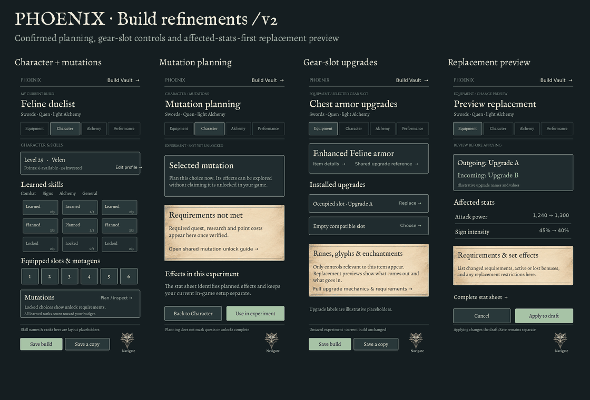
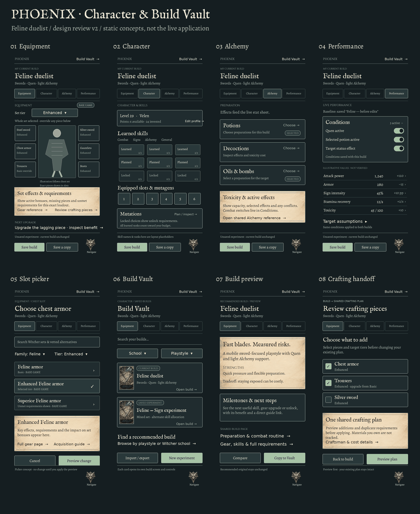

# Character & Build Vault — mockups v2

**[Latest production-slice visual review](reviews/gear-reference-slice.png)** —
shared gear reference and change-preview states; static illustration, not a browser capture.

**Start with the [new revision overview](mockups/00-revision-overview.png), then open a screen below.**



## New in v2

- [Mutation planning](mockups/12-mutation-planning.png): plan a locked mutation with clear unmet requirements and a shared unlock-guide link.
- [Upgrades inside the gear slot](mockups/13-gear-upgrades.png): inspect an occupied slot or choose a compatible empty slot.
- [Replacement preview](mockups/14-replacement-preview.png): outgoing and incoming upgrade, affected stats, requirements and set effects; full sheet expandable; Apply or Cancel.
- [Character screen](mockups/02-character.png): mutations remain inside Character beside learned investments and equipped slots.
- [Equipment screen](mockups/01-equipment.png): the representative character art follows the chest armor’s set; exact pieces remain visible in slots. Actual set artwork is still pending sourcing and visual review.

## Full first-pass gallery

First visual pass for the owner's Feline duelist: swords, Quen and light Alchemy.
These are static design plates, not screenshots of implemented menus. All displayed
stats, skill ranks, point budgets and calculations are illustrative, not verified game
values. The character silhouette and skill tiles are placeholders for the equipment
and learned-tree layout; final iconography and slot arrangement need visual review.



| Open full-size screen | What to review |
|---|---|
| [01 Equipment](mockups/01-equipment.png) | Game-inspired slot layout, whole-set tier and a piece override, shared gear/crafting links |
| [02 Character](mockups/02-character.png) | Learned investments separate from equipped slots; small manual profile |
| [03 Alchemy](mockups/03-alchemy.png) | Preparations feed conditions and performance; shared Alchemy reference |
| [04 Performance](mockups/04-performance.png) | Expandable live conditions, pinned baseline, values plus changes |
| [05 Full-screen slot picker](mockups/05-slot-picker.png) | Set family and tier, requirements, compact summary and shared item page |
| [06 Build Vault](mockups/06-build-vault.png) | Illustrated saved-build cards, school/playstyle filters, pinned current setup |
| [07 Recommended build preview](mockups/07-build-preview.png) | Feel, tradeoffs and milestones; inspect before copying to the Vault |
| [08 Crafting handoff](mockups/08-crafting-handoff.png) | Review pieces and tiers before previewing changes to the one shared plan |
| [09 Landscape performance](mockups/09-performance-landscape.png) | Two-column landscape arrangement with navigation outside the stat column |
| [10 Stat explanation](mockups/10-stat-breakdown.png) | Contributors, illustrative calculation and shared mechanics destination |
| [11 Target assumptions](mockups/11-target-assumptions.png) | Simple conditions, advanced assumptions and shared enemy/mechanics links |

## How the screens connect

Opening Character starts with the designated active build. Equipment, Character,
Alchemy and Performance are tabs for that selected build. A saved experiment opens
its own copy of the same screens and controls. Selecting a slot opens the full-screen
picker; Preview change shows a temporary comparison before Apply or Cancel.

A stat opens its contributors and calculation, with links to the shared reference.
Conditions are saved with each build. Comparing builds aligns conditions first;
using each build's own saved conditions is an explicit option, not a silent mismatch.

Vault opens saved cards. A recommended build opens a preview, then Copy to Vault
creates an editable version. Set as my current build is an explicit separate action
with a differences preview. Save and Save a copy do not imply that designation.
Export/import supports an individual build or the Vault; imports preview conflicts
and never silently overwrite or designate the active setup.

## Shared pages, not duplicate content

| From the build | Reused destination |
|---|---|
| Weapon/armor | Gear entry → acquisition guide → shared crafting plan |
| Skill/mutation | Shared Character reference |
| Potion/decoction/oil/bomb | Alchemy entry |
| Rune/glyph/enchantment | Shared upgrade entry |
| Stat or combat effect | Combat mechanics entry |
| Craftsman or purchase | Merchants / Economy |
| Required quest/unlock | Existing walkthrough at the relevant stage |
| Preparation/combat routine | Shared recommended-build page, also linked from Combat |

Every reference return must restore the build draft, selected slot, active conditions
and comparison baseline. The plates show intended destinations, not working links.

## Scope decisions carried forward

Full record: [DECISIONS.md](DECISIONS.md). All game and expansion content is visible.
Use Base Game, Hearts of Stone and Blood and Wine labels on relevant entries; there
are **no content-scope switches or DLC filters**. Gear school/playstyle filters and
simulation condition switches remain. Witcher sets form the gear catalogue; vetted
non-set exceptions require a recommended-build use and can then be used in any build.

This first pass concentrates on screen hierarchy. Final acquired/required states,
respec warnings, exact mutation/rune data, backup dialogs and
narrow-screen refinements are subsequent mockup states, not completed features.
Nothing here authorizes production implementation, a merge, a deploy or gameplay claims.

## Reproduction and review evidence

The deterministic [render script](render_mockups.py) uses existing Phoenix artwork
and bundled fonts with Pillow/fontTools. Run from the repository root:

```sh
/usr/bin/python3 design/builds-v1/render_mockups.py
```

Static portrait canvas: 390×844 logical pixels rendered at 2×. Landscape: 844×390 at
2×. Visual inspection was done on rendered plates; these are not browser, touch,
VoiceOver or live-stat tests. Production controls need at least 44px touch targets;
a drawn switch is only the visible part of its row target. Numbers and source art
are for layout review. No files under dist, rollback or CI were changed.

## V2 review limits

Six owner decisions are now settled: chest-set artwork, in-slot upgrades, replacement
contents, mutations inside Character, locked-mutation planning with a flag, and changed
stats first. No unanswered defaults remain for these states. The upgrade names and
mutation label are placeholders; compatibility and actual effects require verified
game data. The plates do not implement persistence or live calculations.

## Equipment interaction prototype (development source)

[Open the prototype source](prototype/index.html). GitHub displays HTML source;
it does not run this page. No public preview or live-site change is published.

The prototype implements selectable loadout slots, a full-screen two-school demo
picker, whole-set tier changes, isolated piece overrides, in-slot upgrade changes,
Apply/Cancel previews, a pinned comparison, condition controls, in-memory Save / Save
a copy / Open / Discard and a shared-reference return panel. It is a focused equipment
slice; Character and Alchemy currently link to their approved mockup images.

The page groups an equipment list, character/loadout and selected-item details on
wide screens, then prioritizes the loadout on a phone. This is a game-inspired
structure study, not a claim of exact parity with the owner's current Xbox menus.
The silhouette is still a clearly labelled artwork placeholder. The official
[CDPR manual](https://cdn-l-thewitcher.cdprojektred.com/media/TW3/Pdf/Manuals/PC/The_Witcher_3_Wild_Hunt_Game_Manual_PC_EN.pdf)
is a control/interface reference, not a source of verified current stat formulas
or proof that this prototype matches the current menu geometry.

No localStorage, saved guide progress, APIs or real account state are used. Refresh
clears the demo Vault. All stats use synthetic arithmetic; all upgrade compatibility,
real effects, requirements, final artwork and persistent Vault behavior remain out
of scope for this first prototype. No real game formulas are implied.

Checks: JavaScript syntax; model checks for non-mutating proposals, isolated slot
changes, whole-tier changes, preserving mixed schools, independent baseline snapshots,
synthetic condition effects and invalid-input refusal. Browser layout, modal focus,
touch and Safari are not verified. Before visual acceptance, supply a runnable preview
and representative set art; do not ask the owner to judge HTML source as the final UI.

To run locally from the repo root in a capable development environment:

```sh
python3 -m http.server 8772
# Open http://localhost:8772/design/builds-v1/prototype/index.html
```
