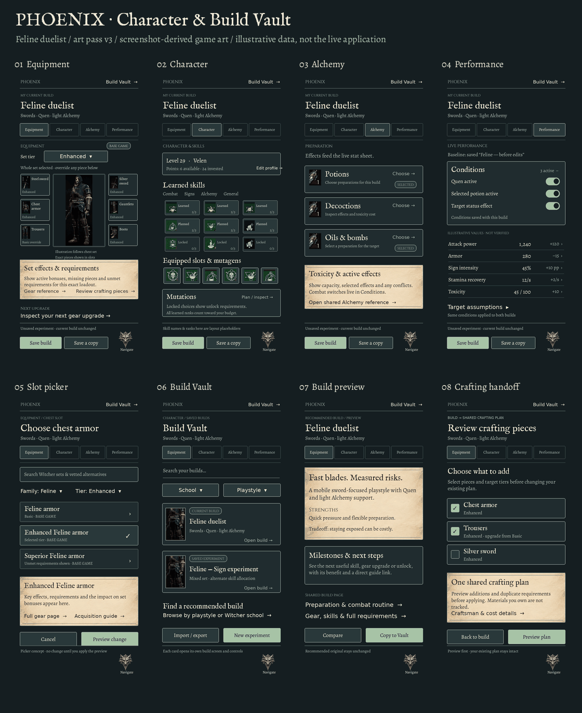

# Character & Build Vault — game-art mockups

**[Open Equipment first](01-equipment.png)** · **[View the main overview](00-overview.png)** · **[View supporting states](00-revision-overview.png)**

This art pass replaces the generic character silhouette and skill tiles with
screenshot-derived game artwork. It is a complete review set for the agreed flows,
not a claim that the final app, game calculations or current-version data are complete.

| Screen | Open image |
|---|---|
| Equipment around the character | [Equipment](01-equipment.png) |
| Learned tree, equipped slots and mutations | [Character](02-character.png) |
| Preparations and shared reference | [Alchemy](03-alchemy.png) |
| Conditions and stat deltas | [Performance](04-performance.png) |
| Choosing a piece / tier | [Slot picker](05-slot-picker.png) |
| Saved builds | [Build Vault](06-build-vault.png) |
| Recommended build | [Build preview](07-build-preview.png) |
| Pieces to shared crafting plan | [Crafting handoff](08-crafting-handoff.png) |
| Phone landscape | [Landscape performance](09-performance-landscape.png) |
| Contributors and calculation | [Stat breakdown](10-stat-breakdown.png) |
| Simple and advanced assumptions | [Target controls](11-target-assumptions.png) |
| Locked choice with planning flag | [Mutation planning](12-mutation-planning.png) |
| Upgrade controls inside a slot | [Gear upgrades](13-gear-upgrades.png) |
| Outgoing / incoming upgrade and affected stats | [Replacement preview](14-replacement-preview.png) |
| File validation and conflict review | [Import preview](15-import-preview.png) |
| Explicit current-build change | [Designation review](16-designation-review.png) |
| Same-condition comparison | [Build comparison](17-build-comparison.png) |

## Artwork and accuracy

The Geralt illustration and item thumbnails come from the Cat School inventory
screenshot credited in [ART-SOURCES.json](../ART-SOURCES.json). The skill icons come
from RPG Site's game-menu comparison screenshot. Copyright in game art remains
with CD PROJEKT RED and respective rights holders; screenshot creators are credited.
These are visual-reference crops, not a newly extracted or licensed production icon
pack. Do not treat this art pass as final production-asset clearance.

Character artwork represents Feline gear; it does not dynamically represent every
selected tier or mixed piece. The thumbnails likewise demonstrate visual treatment,
not a verified icon for every tier. Exact per-tier production art remains a separate
asset task. The historical skill screenshot is a visual source only: its old ranks,
values and mutation behavior are not accepted as current Remastered mechanics.

All mocked numbers, skill allocations and comparisons remain illustrative. No art
pass changes the production catalogue's version/provenance flags. The artwork makes
layout review concrete; it does not certify a playable build.

## Review status

19 PNGs: two overview sheets, sixteen portrait states and one landscape state.
Portraits are 390×844 logical pixels at 2×; landscape is 844×390 at 2×. Images were
rendered and visually inspected, including overview sheets. They are static images,
not browser captures. The composition adapts game-menu ideas for phone reading;
exact current Xbox menu parity and physical Safari remain unverified.

Reproduction: `/usr/bin/python3 design/builds-v1/render_art_mockups.py` from repo root.
It fetches the two credited sources into a local cache and verifies their hashes.
No application files or stored progress are changed by this design revision.
