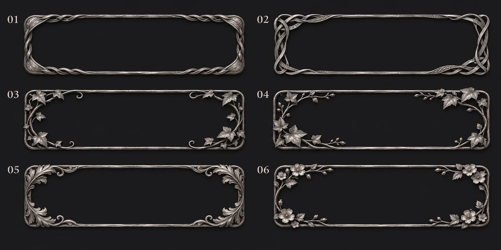

# Standalone quest header frames

Batch 1, asset 1. Six standalone silver frame references for the new default art direction.

01 layered braid, 02 openwork knots, 03 curling ivy, 04 layered ivy branches, 05 acanthus scrolls, 06 hawthorn blossoms.

Keep the rails narrow. Use layered metal, engraving and relief for depth. Keep the frame independent of the inset artwork. The inset art is reviewed separately. This sheet is a visual source reference. Runtime frame exports and test-page verification are pending.

