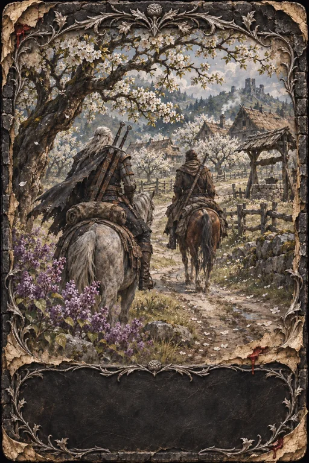
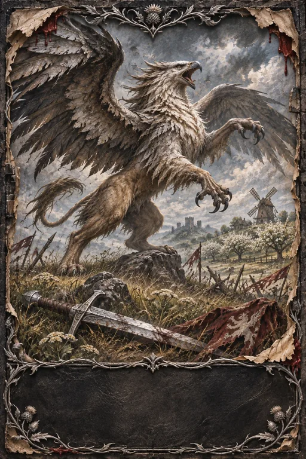
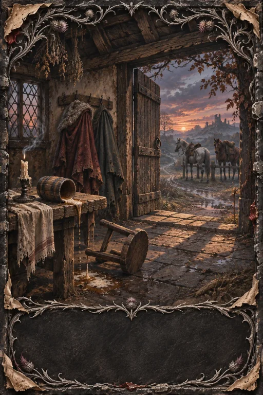
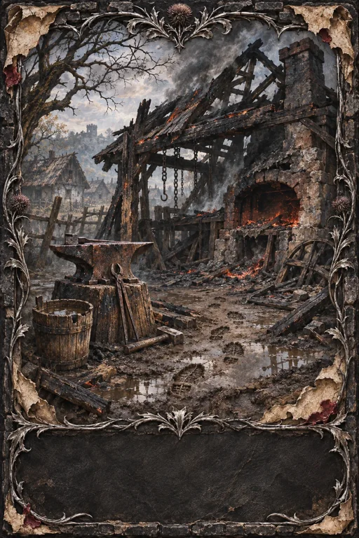
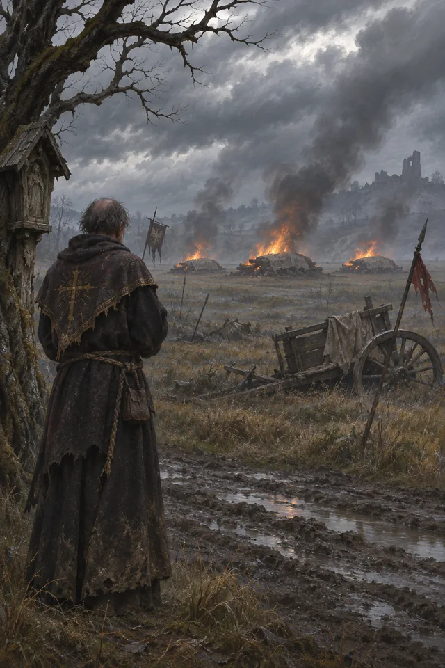
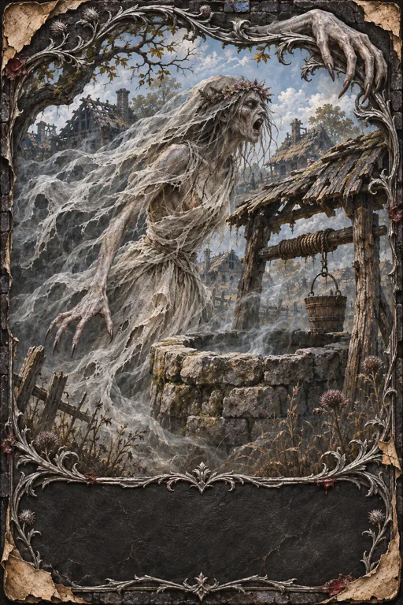
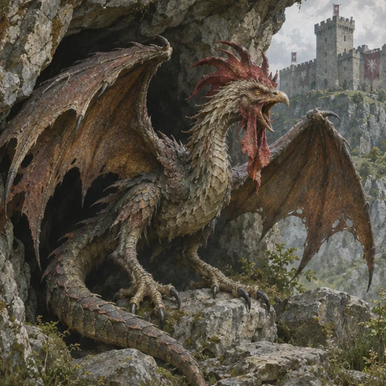

# Batch 1 · Existing quest insets

| White Orchard | Velen |
|---|---|
| 001 · Lilac and Gooseberries  | 002 · The Nilfgaardian Connection  |
| 003 · The Beast of White Orchard  | 004 · Bloody Baron  |
| 005 · The Incident at White Orchard  | 006 · Hunting a Witch  |
| 007 · Twisted Firestarter  | 008 · Funeral Pyres  |
| 009 · Devil by the Well  | 010 · Shrieker  |
