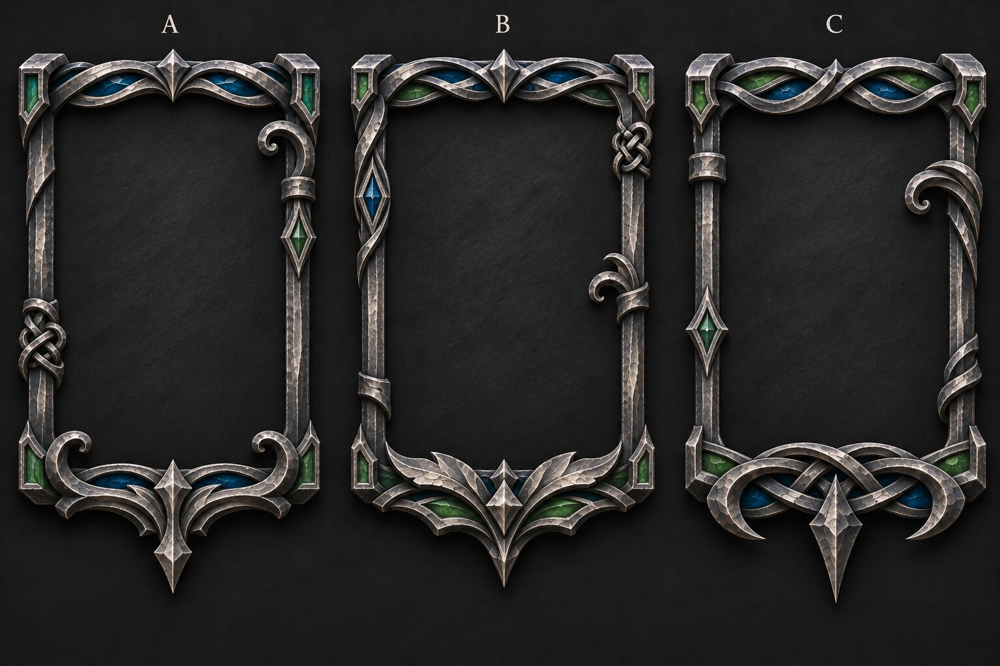
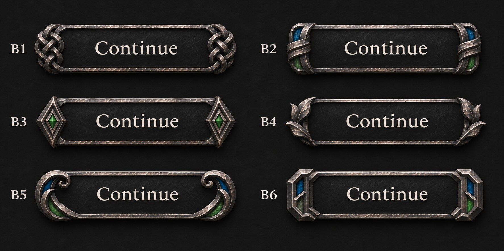

# Phoenix framing review

The owner approved the enlarged [number strip](number-strip.jpg) as the framing direction on November 18, 2026. See the [art standard](../../ART-STANDARD.md) for the production rules. The render's wolf is illustrative. Production uses the existing shared wolf pointer.

## Review concepts

| Concept | Where it applies | What to review |
| --- | --- | --- |
| [Quest card](quest-card.jpg) | Quest, contract, treasure, activity, and region decks | The raised border holds its own against illustrated card art while leaving room for the subject and title. |
| [Walkthrough](walkthrough.jpg) | Quest hubs, walkthroughs, and parchment reading surfaces | Keep the metal outside the reading area. Scale the frame to the panel and retain clear space around text and controls. |
| [Primary action](primary-action.jpg) | Walkthrough, hub, resume, and map action tiles | Give the full-width art and label a bold surround with thinner bands on shorter buttons. |
| [Regional map](regional-map.jpg) | Regional, cluster, and quest route map surfaces | Let the frame define the perimeter while keeping markers, labels, and gestures clear. |
| [Resources](resources.jpg) | Resource and navigation overlays and fanned cards | Distinguish each card edge from the overlay surround. Keep the reveal and dismiss targets clear. |
| [Item and diagram](item-and-diagram.jpg) | Gear, inventory, diagram, merchant, and compact reference tiles | Reduce the width and density of the interlace to fit small cards. |

These are visual concepts. Controls, labels, and behavior in the guide follow the page templates. Review and approve each frame before using it in the application.

## Box flourishes and staggered side details

- **A** uses an upward-opening curled brace with a pointed drop.
- **B** uses split leaves with a central diamond.
- **C** uses a broad interlaced knot with a spearpoint.

The side rails show alternating curls, knots, collars, and inlaid lozenges at irregular heights. These are fixed compositions for review. Blue and jade are the current accents and may change.

## Seven additional bottom flourishes

| Variant | Motif |
| --- | --- |
| D | Stacked chevrons and open diamond |
| E | Chain links around a circular inlay |
| F | Crossed hooks and pointed drop |
| G | Crescent with a split arrowhead |
| H | Stepped shoulders and faceted shield |
| I | Folded wings and three-pronged drop |
| J | Three-lobed knot and flat pendant |

The approved rotation uses A–J in that order, wrapping to A.

## Vertical side rails

| Concept | Side details |
| --- | --- |
| V1 | Compact interlacing knots and wrapped steel collars |
| V2 | Recessed lozenges and angled steel splints |
| V3 | Raised curls and folded leaves |

For review: compare how the staggered ornaments read against the quieter lengths of forged steel. Keep the left and right ornaments at different heights and allow room for the framed content. Blue and jade remain adjustable accents.

## Vine-inspired vertical rails

| Pair | Motif |
| --- | --- |
| V4 | Broad ivy leaves |
| V5 | Twining tendrils and slender leaves |
| V6 | Hooked briar and inset bud |
| V7 | Grapevine coils and lobed leaves |
| V8 | Fern fronds and fiddleheads |
| V9 | Bare winter vine and forked tips |

The proposed sequence is V1 → V4 → V5 → V2 → V6 → V7 → V3 → V8 → V9, then back to V1. The side-rail pair stays with its box. The bottom flourish has its own rotation.

## Standard text-only buttons

B1–B6 explore a knot, wrapped collar, inlaid diamond, ivy leaf, tendril, and stepped steel cap. The same sample label makes it easier to compare readability and ornament size. The template rotates B1–B10 across repeated peer actions and keeps assignments stable. The artwork is available for visual review.

### Four additional button variants

| Variant | End detail |
| --- | --- |
| B7 | Crossed steel splints |
| B8 | Fluted fan caps |
| B9 | Beveled shields with blue enamel rivets |
| B10 | Folded chevrons with jade channels |
