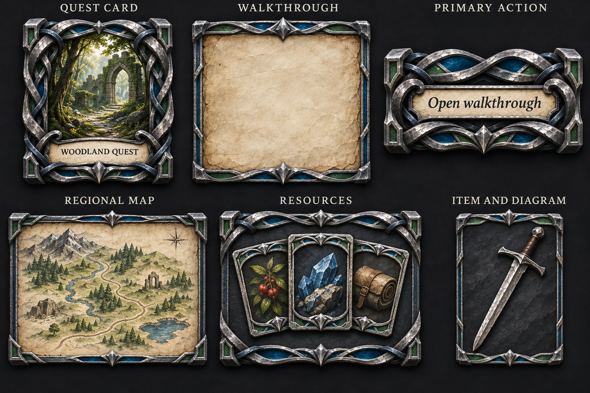

# Phoenix framing review

The owner approved the enlarged [number strip](number-strip.jpg) as the framing direction on November 18, 2026. See the [art standard](../../ART-STANDARD.md) for the production rules. The render's wolf is illustrative. Production uses the existing shared wolf pointer.

## Review concepts

| Concept | Where it applies | What to review |
| --- | --- | --- |
| [Quest card](quest-card.jpg) | Quest, contract, treasure, activity, and region decks | The raised border holds its own against illustrated card art while leaving room for the subject and title. |
| [Walkthrough](walkthrough.jpg) | Quest hubs, walkthroughs, and parchment reading surfaces | Keep the metal outside the reading area. Scale the frame to the panel and retain clear space around text and controls. |
| [Primary action](primary-action.jpg) | Walkthrough, hub, resume, and map action tiles | Give the full-width art and label a bold surround with thinner bands on shorter buttons. |
| [Regional map](regional-map.jpg) | Regional, cluster, and quest route map surfaces | Let the frame define the perimeter while keeping markers, labels, and gestures clear. |
| [Resources](resources.jpg) | Resource and navigation overlays and fanned cards | Distinguish each card edge from the overlay surround. Keep the reveal and dismiss targets clear. |
| [Item and diagram](item-and-diagram.jpg) | Gear, inventory, diagram, merchant, and compact reference tiles | Reduce the width and density of the interlace to fit small cards. |

These are visual concepts. Controls, labels, and behavior in the guide follow the page templates. Review and approve each frame before using it in the application.
