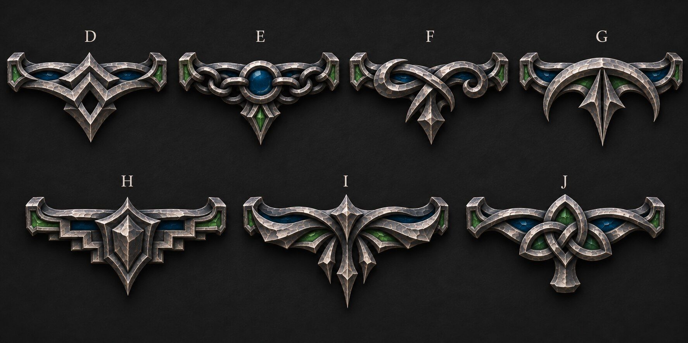
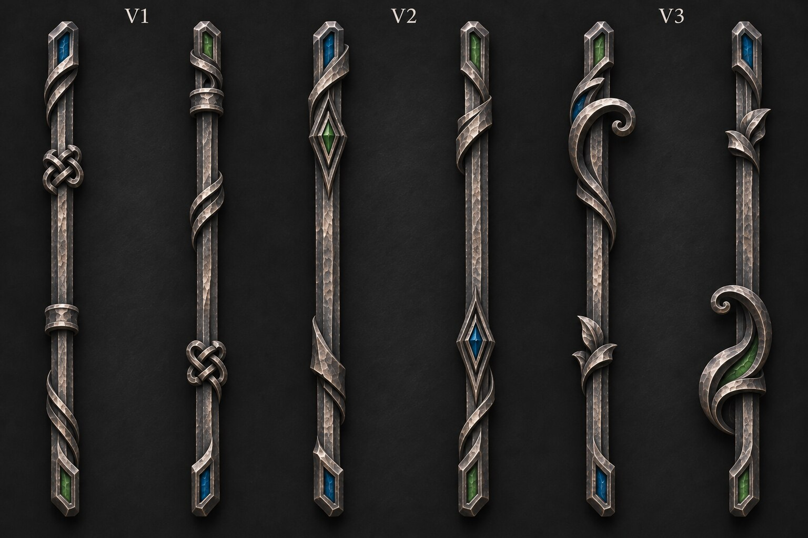
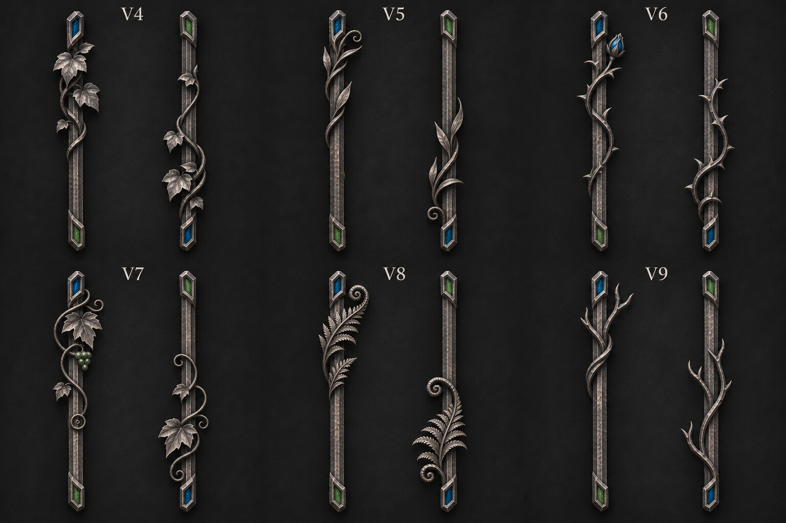
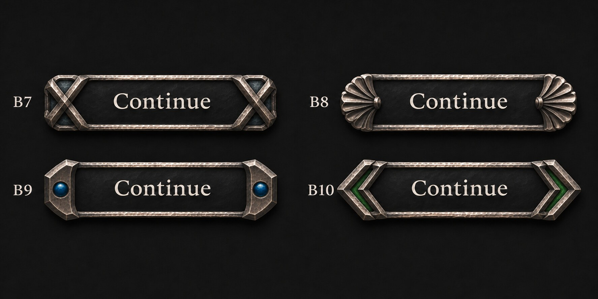
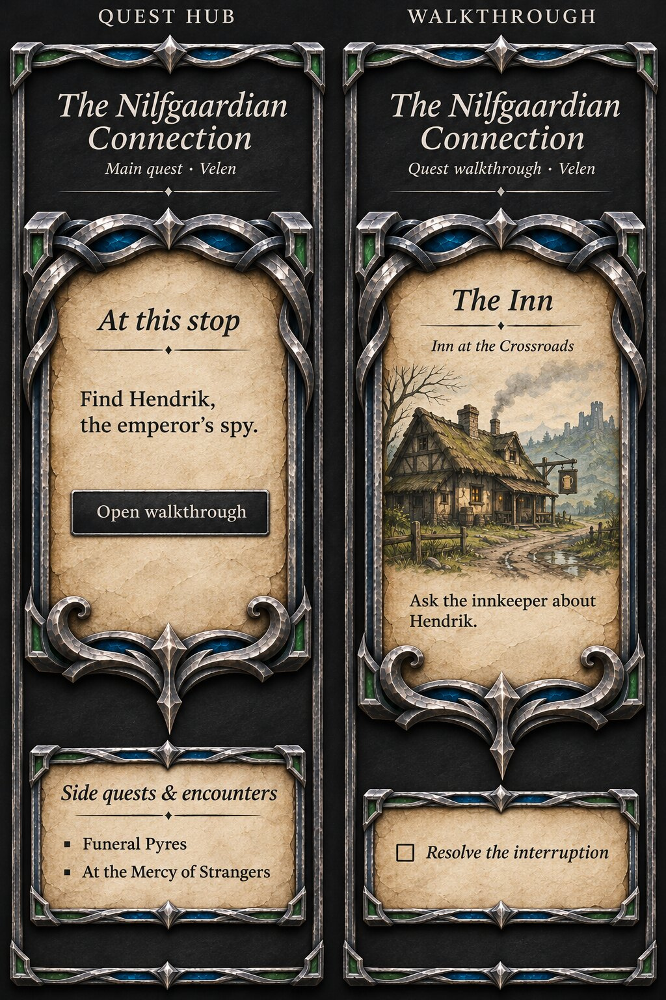

# Phoenix framing review

The owner approved the enlarged [number strip](number-strip.jpg) as the framing direction on November 18, 2026. See the [art standard](../../ART-STANDARD.md) for the production rules. The render's wolf is illustrative. Production uses the existing shared wolf pointer.

## Review concepts

| Concept | Where it applies | What to review |
| --- | --- | --- |
| [Quest card](quest-card.jpg) | Quest, contract, treasure, activity, and region decks | The raised border holds its own against illustrated card art while leaving room for the subject and title. |
| [Walkthrough](walkthrough.jpg) | Quest hubs, walkthroughs, and parchment reading surfaces | Keep the metal outside the reading area. Scale the frame to the panel and retain clear space around text and controls. |
| [Primary action](primary-action.jpg) | Walkthrough, hub, resume, and map action tiles | Give the full-width art and label a bold surround with thinner bands on shorter buttons. |
| [Regional map](regional-map.jpg) | Regional, cluster, and quest route map surfaces | Let the frame define the perimeter while keeping markers, labels, and gestures clear. |
| [Resources](resources.jpg) | Resource and navigation overlays and fanned cards | Distinguish each card edge from the overlay surround. Keep the reveal and dismiss targets clear. |
| [Item and diagram](item-and-diagram.jpg) | Gear, inventory, diagram, merchant, and compact reference tiles | Reduce the width and density of the interlace to fit small cards. |

These are visual concepts. Controls, labels, and behavior in the guide follow the page templates. Review and approve each frame before using it in the application.

## Box flourishes and staggered side details

- **A** uses an upward-opening curled brace with a pointed drop.
- **B** uses split leaves with a central diamond.
- **C** uses a broad interlaced knot with a spearpoint.

The side rails show alternating curls, knots, collars, and inlaid lozenges at irregular heights. These are fixed compositions for review. Blue and jade are the current accents and may change.

## Seven additional bottom flourishes

| Variant | Motif |
| --- | --- |
| D | Stacked chevrons and open diamond |
| E | Chain links around a circular inlay |
| F | Crossed hooks and pointed drop |
| G | Crescent with a split arrowhead |
| H | Stepped shoulders and faceted shield |
| I | Folded wings and three-pronged drop |
| J | Three-lobed knot and flat pendant |

The approved rotation uses A–J in that order, wrapping to A.

## Vertical side rails

| Concept | Side details |
| --- | --- |
| V1 | Compact interlacing knots and wrapped steel collars |
| V2 | Recessed lozenges and angled steel splints |
| V3 | Raised curls and folded leaves |

For review: compare how the staggered ornaments read against the quieter lengths of forged steel. Keep the left and right ornaments at different heights and allow room for the framed content. Blue and jade remain adjustable accents.

## Vine-inspired vertical rails

| Pair | Motif |
| --- | --- |
| V4 | Broad ivy leaves |
| V5 | Twining tendrils and slender leaves |
| V6 | Hooked briar and inset bud |
| V7 | Grapevine coils and lobed leaves |
| V8 | Fern fronds and fiddleheads |
| V9 | Bare winter vine and forked tips |

The proposed sequence is V1 → V4 → V5 → V2 → V6 → V7 → V3 → V8 → V9, then back to V1. The side-rail pair stays with its box. The bottom flourish has its own rotation.

## Standard text-only buttons

B1–B6 explore a knot, wrapped collar, inlaid diamond, ivy leaf, tendril, and stepped steel cap. The same sample label makes it easier to compare readability and ornament size. All ten variants are approved. Rotate B1–B10 across pages. Every standard text-only button on a page uses that page’s assigned variant.

### Four additional button variants

| Variant | End detail |
| --- | --- |
| B7 | Crossed steel splints |
| B8 | Fluted fan caps |
| B9 | Beveled shields with blue enamel rivets |
| B10 | Folded chevrons with jade channels |

## The Nilfgaardian Connection box framing pilot

Box framing passed owner review. Both iPhone concepts frame every visible content box, with curled-brace A on each main panel and lighter trim on smaller boxes. The illustration and simplified content are mockup material. Vertical side ornament and standard text-only button treatments have their own review passes, in that order after box framing.

## Velen box framing, batch 1

Owner approved the box framing on all five quest hub and walkthrough pairs. The pilot uses A. This batch continues with B–F on the main panels, with lighter trim on secondary boxes.

| Quest | Setting | Main flourish | Source art |
| --- | --- | --- | --- |
| [Bloody Baron](velen-box-batch-01/baron.jpg) | Crow’s Perch | B · Split leaf | `dist/art-velen/baron.webp` |
| [Family Matters](velen-box-batch-01/family-matters.jpg) | Crow’s Perch | C · Interlaced knot | `dist/art-velen/family-matters.webp` |
| [Hunting a Witch](velen-box-batch-01/witch.jpg) | Midcopse | D · Stacked chevrons | `dist/art-velen/witch.webp` |
| [Wandering in the Dark](velen-box-batch-01/wandering-in-the-dark.jpg) | Elven ruins | E · Chain links and circular inlay | `dist/art-velen/wandering-in-the-dark.webp` |
| [Ladies of the Wood](velen-box-batch-01/ladies-of-the-wood.jpg) | Crookback Bog | F · Crossed hooks | `dist/art-velen/ladies-of-the-wood.webp` |

The images capture visual reference for frame weight, scale, and motif placement. Quest artwork guided the concepts. Rendered illustrations and sample labels are mockup material. Omit incidental generated labels such as “Lost in the Ruins” from production. Use the existing quest data and original art files in implementation. Subsequent review batches use ten quests. Vertical ornament and button styles are separate passes.

## Velen box framing, batch 2

Owner approved box framing for these ten quests. Each sheet has two quest rows, with the hub on the left and walkthrough on the right. The A–J rotation continues at G and wraps after J. The hub and walkthrough share the quest's main flourish.

| Quest | Main flourish | Sheet | Source artwork |
| --- | --- | --- | --- |
| A Princess in Distress | G | [01 · top](velen-box-batch-02/sheet-01.jpg) | `dist/art-velen/princess.webp` |
| Ciri’s Room | H | [01 · bottom](velen-box-batch-02/sheet-01.jpg) | `dist/art-velen/ciris-room.webp` |
| Magic Lamp | I | [02 · top](velen-box-batch-02/sheet-02.jpg) | `dist/art-velen/magic-lamp.webp` |
| The Whispering Hillock | J | [02 · bottom](velen-box-batch-02/sheet-02.jpg) | `dist/art-velen/whispering-hillock.webp` |
| Ciri’s Story: The King of the Wolves | A | [03 · top](velen-box-batch-02/sheet-03.jpg) | `dist/art-velen/king-of-the-wolves.webp` |
| Return to Crookback Bog | B | [03 · bottom](velen-box-batch-02/sheet-03.jpg) | `dist/art-velen/return-to-crookback-bog.webp` |
| Ciri’s Story: Fleeing the Bog | C | [04 · top](velen-box-batch-02/sheet-04.jpg) | `dist/art-velen/fleeing-the-bog.webp` |
| An Invitation from Keira Metz | D | [04 · bottom](velen-box-batch-02/sheet-04.jpg) | `dist/art-velen/keira-invitation.webp` |
| A Towerful of Mice | E | [05 · top](velen-box-batch-02/sheet-05.jpg) | `dist/art-velen/towerful-of-mice.webp` |
| A Favor for a Friend | F | [05 · bottom](velen-box-batch-02/sheet-05.jpg) | `dist/art-velen/favor-for-a-friend.webp` |

The box approval covers the perimeter, centerpiece scale, and space available for content. The Keira invitation render depicts a shield-shaped bottom flourish and a sample main-quest label. Its production references are flourish D and the existing side-quest classification. Stand-in labels, illustration variations, and any side ornament in the concept renders are incidental. Use the original quest artwork, quest data, and standard controls for implementation. The side rails and text-only buttons have their own review passes.

## Velen vertical framing, batch 2

The same ten approved box-framing references carry forward. Each proof adds the assigned pair to the outer left and right edges of the hub and walkthrough. Box flourishes and buttons remain as shown in the base sheets. The template uses staggered rail ornaments and keeps the same pair with both views of a quest. The review sequence wraps to V1 after V9.

| Quest | Vertical pair | Review sheet |
| --- | --- | --- |
| A Princess in Distress | V1 | [01 · top](velen-vertical-batch-02/sheet-01.jpg) |
| Ciri’s Room | V4 | [01 · bottom](velen-vertical-batch-02/sheet-01.jpg) |
| Magic Lamp | V5 | [02 · top](velen-vertical-batch-02/sheet-02.jpg) |
| The Whispering Hillock | V2 | [02 · bottom](velen-vertical-batch-02/sheet-02.jpg) |
| Ciri’s Story: The King of the Wolves | V6 | [03 · top](velen-vertical-batch-02/sheet-03.jpg) |
| Return to Crookback Bog | V7 | [03 · bottom](velen-vertical-batch-02/sheet-03.jpg) |
| Ciri’s Story: Fleeing the Bog | V3 | [04 · top](velen-vertical-batch-02/sheet-04.jpg) |
| An Invitation from Keira Metz | V8 | [04 · bottom](velen-vertical-batch-02/sheet-04.jpg) |
| A Towerful of Mice | V9 | [05 · top](velen-vertical-batch-02/sheet-05.jpg) |
| A Favor for a Friend | V1 | [05 · bottom](velen-vertical-batch-02/sheet-05.jpg) |

Review the outer side ornament only. These layered proofs retain the earlier concept renders below the rails, including any incidental inner-side detail. Application sizing and clearance around controls still need iPhone testing. The text-button pass follows vertical approval.
