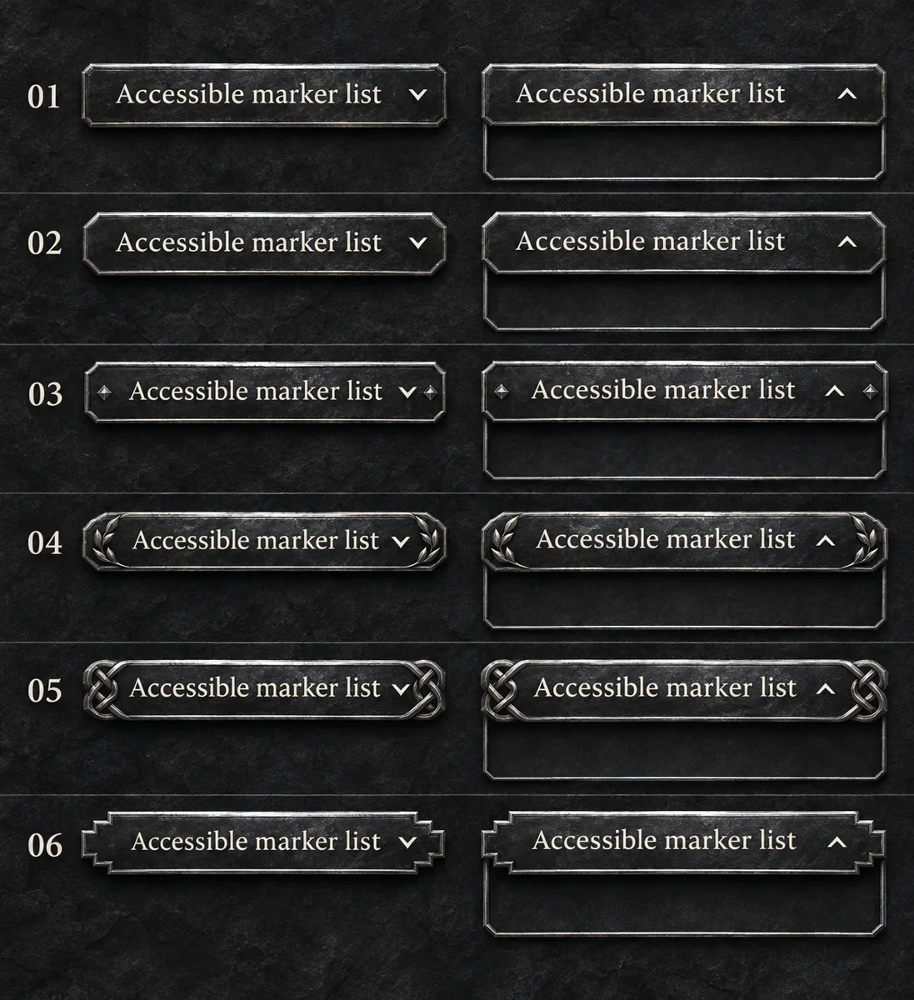

# Accessible marker list

Six approved default dark-style variants. Parchment and light adaptations are deferred.

01 fine bevel, 02 clipped corners, 03 inset diamonds, 04 split leaves, 05 interlaced ends, 06 stepped steel.

Match the adjacent Map legend & coverage header. Keep the live label, trailing chevron, native disclosure semantics, and visible focus. The sheet shows collapsed on the left and expanded on the right. Runtime implementation is pending.

