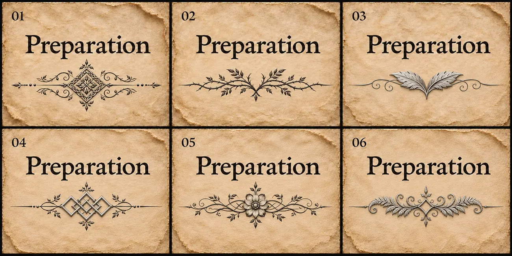
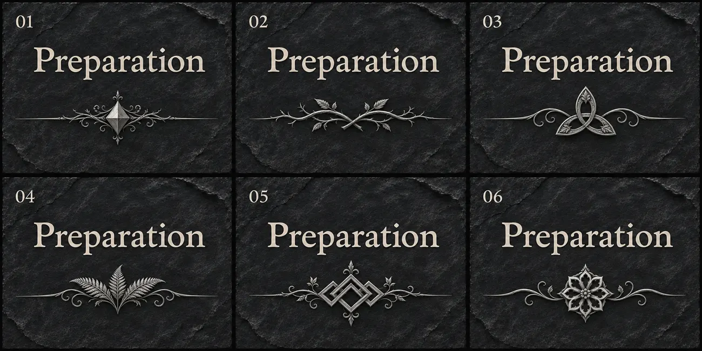

# Approved section dividers and heading ornaments

Owner approved November 21, 2026. These twelve designs are the exclusive source for decorative section dividers and heading ornaments across Operation Phoenix, including Velen and White Orchard. Choose the set that matches the surface. Preserve the proportions, fine lines and intricate centers of these final sheets. The earlier studies are historical. The riveted crescent is outside the approved set.

| ID | Parchment | ID | Dark stone |
| --- | --- | --- | --- |
| P01 | Braided diamond and curling leafwork | D01 | Faceted lozenge with engraved scrollwork |
| P02 | Mirrored ink briar | D02 | Crossed silver briar |
| P03 | Engraved silver split leaves | D03 | Openwork steel trefoil |
| P04 | Openwork silver diamond knot | D04 | Silver fern fan |
| P05 | Rosette and interwoven ink tendrils | D05 | Open chevron knot |
| P06 | Silver fern curls and open lozenge | D06 | Pierced silver rosette |

## Parchment

## Dark stone

## Use in the guide

The sheets are full-layout visual references for the approved designs. For a build, use the selected ornament alone on its approved surface, with the heading rendered as live text. Keep the ornament decorative and verify its legibility and spacing in the iPhone preview. Record the motif ID with any production derivative. Additions or replacements require owner approval. Review new candidates in sets of six per surface.
