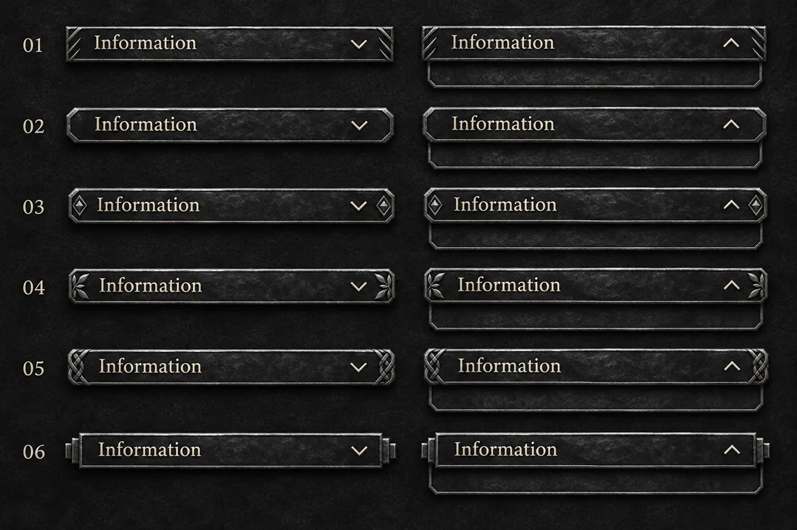

# Approved Information disclosure

All six default dark-style variants are approved. Parchment and light adaptations are deferred.

01 engraved ticks, 02 beveled corners, 03 inset diamonds, 04 split leaves, 05 braided ends, 06 stepped caps.

Match the sibling Related optional tasks disclosure in trim and chevron alignment. Use the live Information label and no counter. Keep the native disclosure behavior and a visible focus state.

Runtime implementation is pending.
