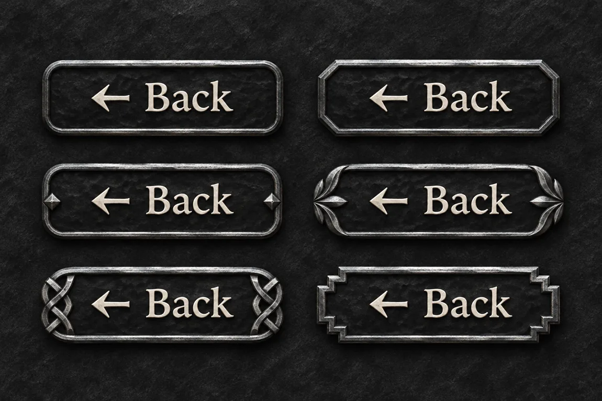

# Approved Map Back control

Six default dark-style variants are approved. Parchment and light adaptations are deferred.

01 fine bevel, 02 clipped corners, 03 inset diamonds, 04 split leaves, 05 interlaced ends, 06 stepped steel. Read unnumbered sheets left to right, top to bottom.

Keep the silver back arrow and live label. Preserve the exact walkthrough return state.

Runtime implementation is pending.
