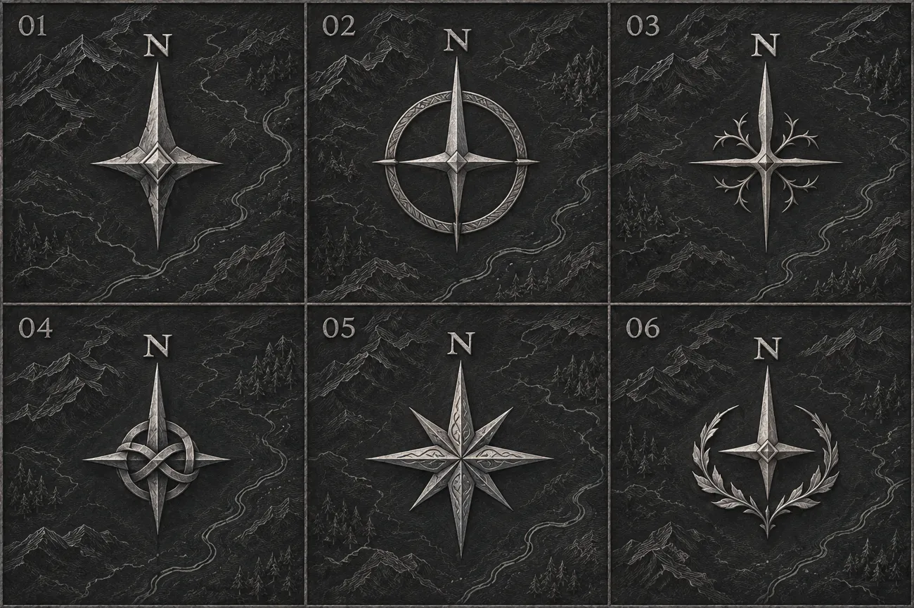
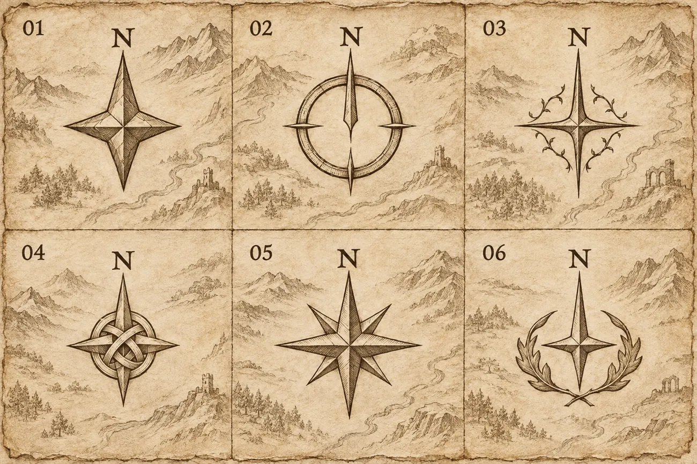
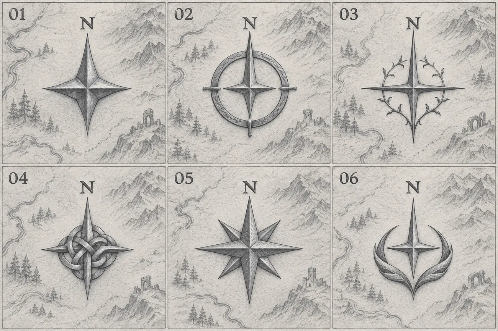

# Approved map compass roses

The owner approved all 18 compass roses. Match the artwork to the surface. IDs are D01–D06 for dark stone, P01–P06 for parchment, and L01–L06 for light limestone.

01 chiseled diamond, 02 engraved ring, 03 thorn curls, 04 interlaced knot, 05 eight-point star, 06 split-leaf cradle.

The dark-stone sheet carries forward fine silver terrain outlines. Use the compass as an orientation cue and keep its north label readable at iPhone size. The preview terrain is illustrative.

## Dark stone

## Parchment

## Light limestone

