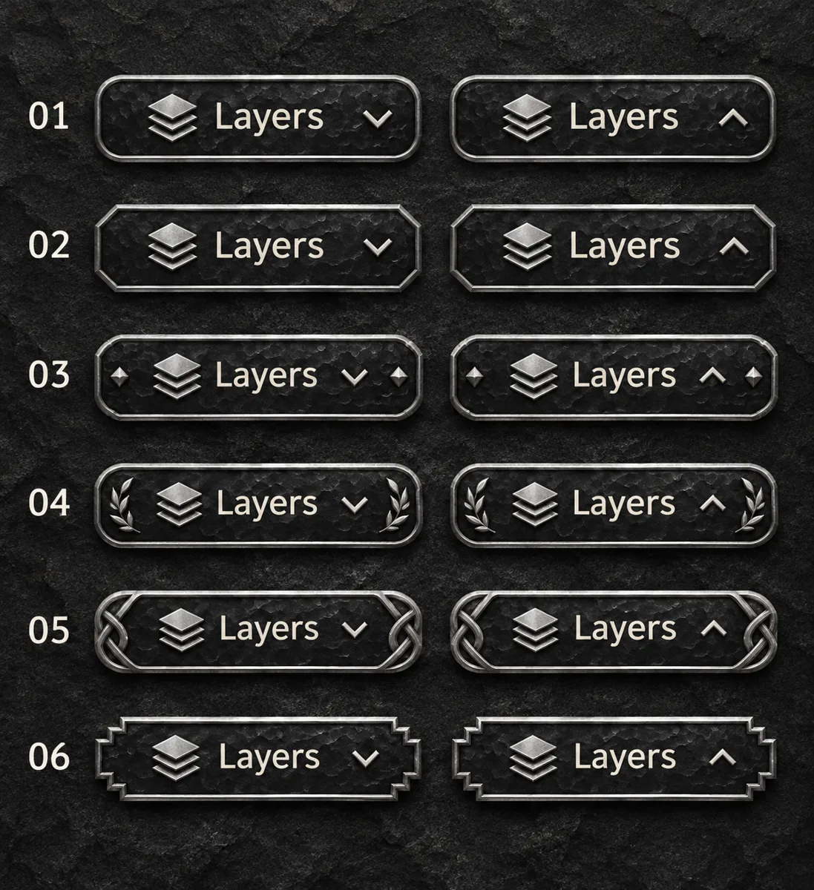

# Approved Map Layers control

Six default dark-style variants are approved. Parchment and light adaptations are deferred.

01 fine bevel, 02 clipped corners, 03 inset diamonds, 04 split leaves, 05 interlaced ends, 06 stepped steel. Read unnumbered sheets left to right, top to bottom.

Use the stacked-layers icon and live label. The downward and upward chevrons indicate collapsed and expanded states, respectively. Match Back and Recenter in the toolbar.

Runtime implementation is pending.
