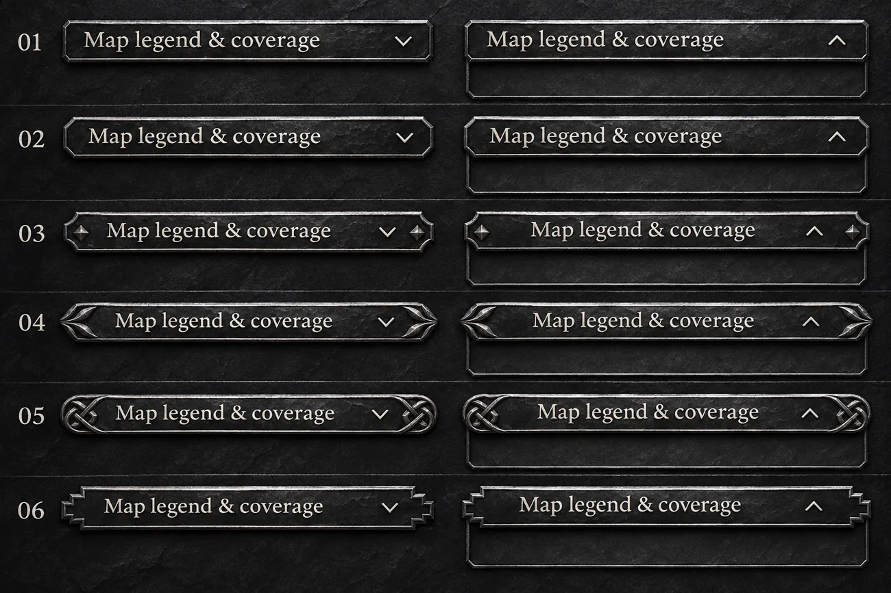

# Map legend & coverage disclosure

Six approved default dark-style variants. Parchment and light adaptations are deferred.

01 fine bevel, 02 clipped corners, 03 inset diamonds, 04 split leaves, 05 interlaced ends, 06 stepped steel.

Keep the live label and trailing chevron. The collapsed state uses a downward chevron, the expanded state an upward chevron. Runtime implementation is pending.

