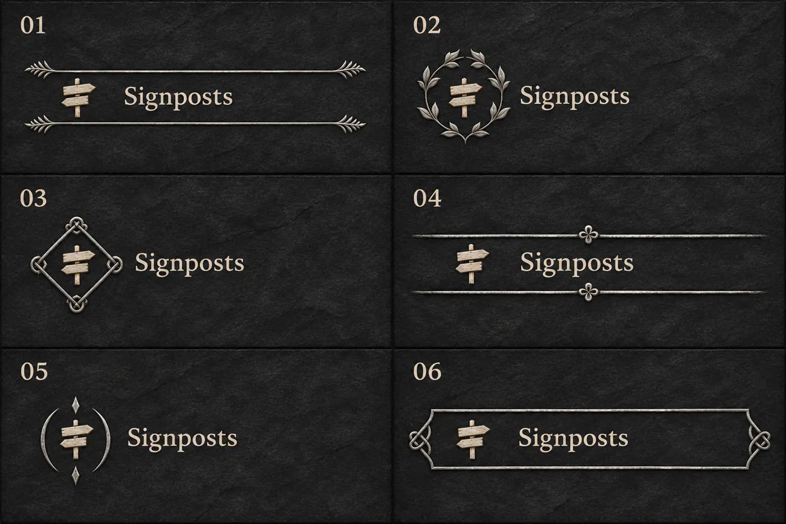
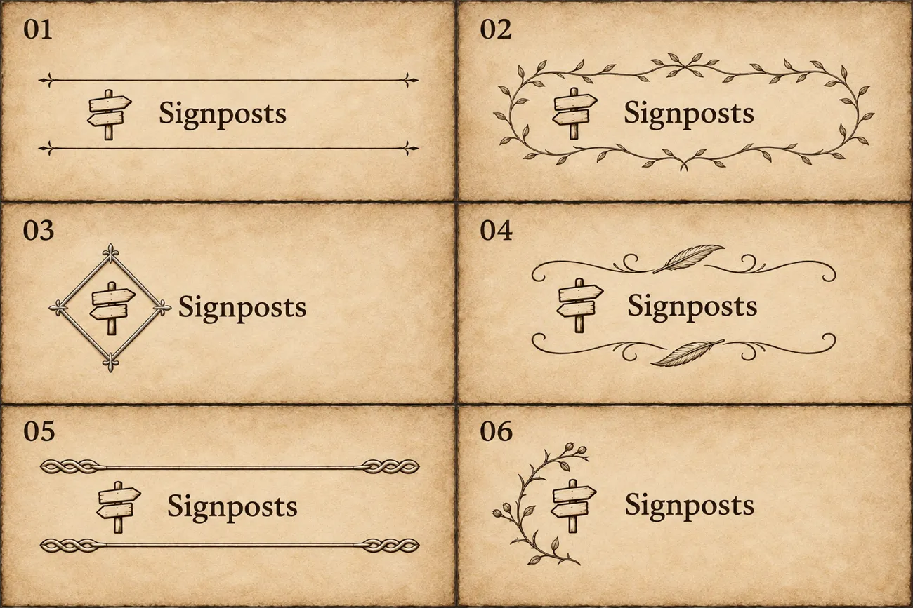
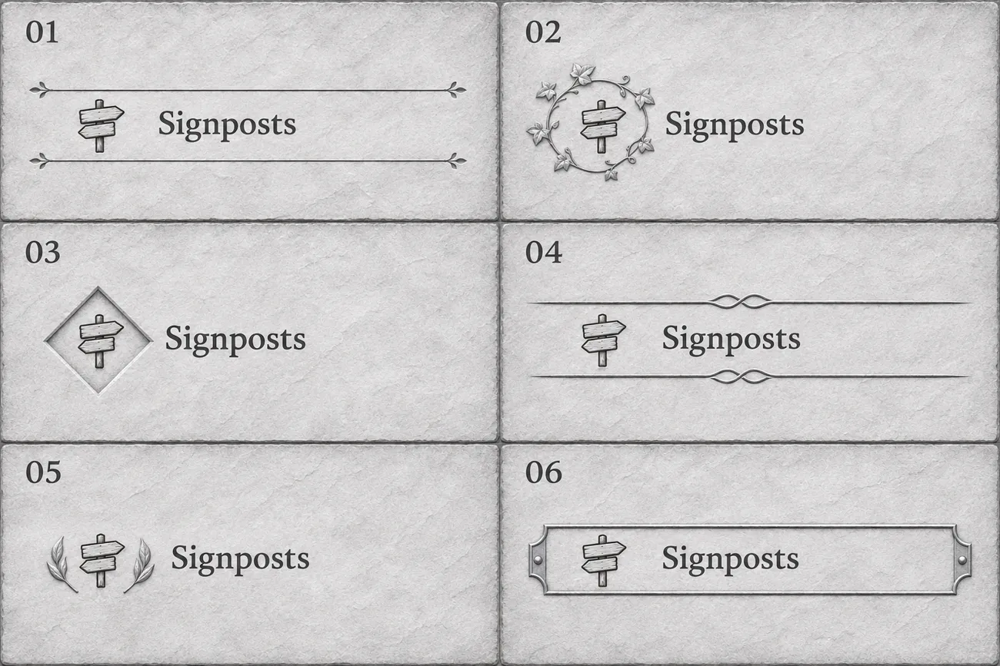

# Approved map legend trim

The owner approved all 18 treatments. Use the approved set matching the background. IDs are D01–D06 for dark stone, P01–P06 for parchment, and L01–L06 for light limestone. The signpost illustrates spacing. Runtime legends use the established map symbols and live labels. Review decorative trim alongside the longest labels at iPhone size.

## Dark stone

## Parchment

## Light limestone

