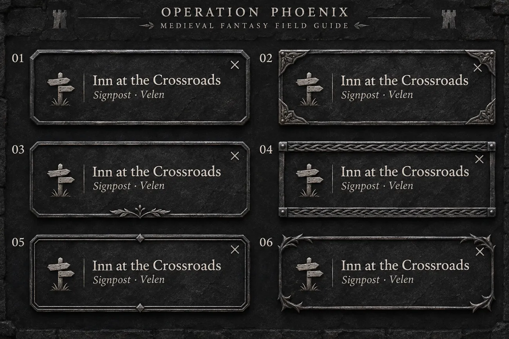
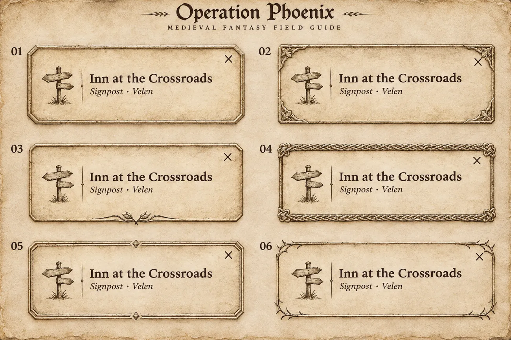
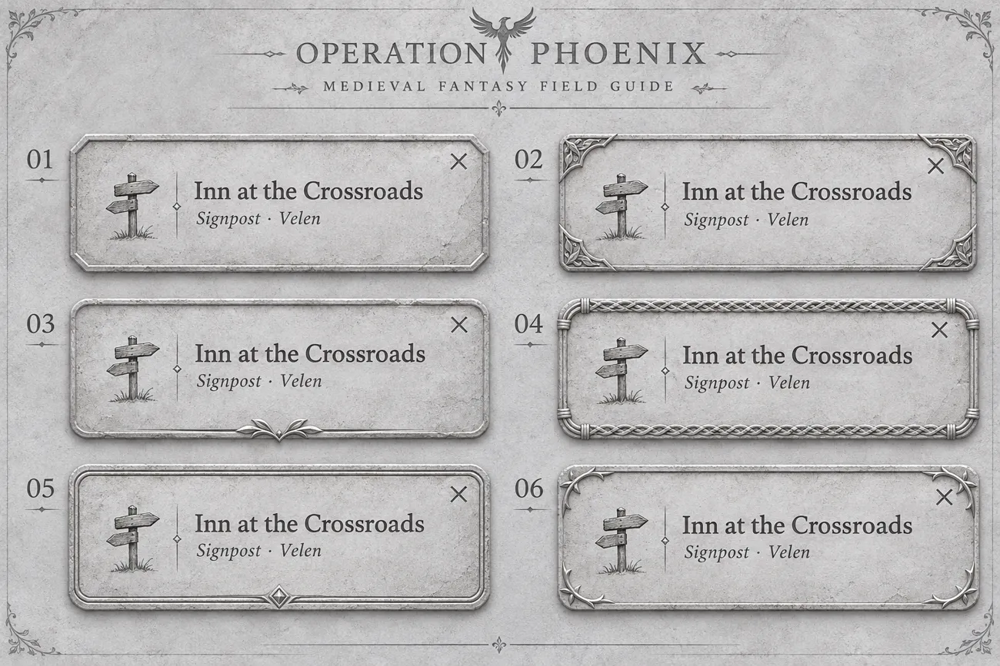

# Approved map location card frames

The owner approved all 18 frames. Match the frame set to the background. IDs are D01–D06 for dark stone, P01–P06 for parchment, and L01–L06 for light limestone.

01 beveled edge, 02 engraved corners, 03 split-leaf base, 04 braided rails, 05 double rule with diamond, 06 thorn corners.

Use these frames for the location cards that open from map markers. The sample title and signpost illustrate the layout. Use live text and the existing map symbol for the selected location. Keep decorative elements clear of the title and close control. Check the longest titles and the close target at iPhone size.

## Dark stone

## Parchment

## Light limestone

