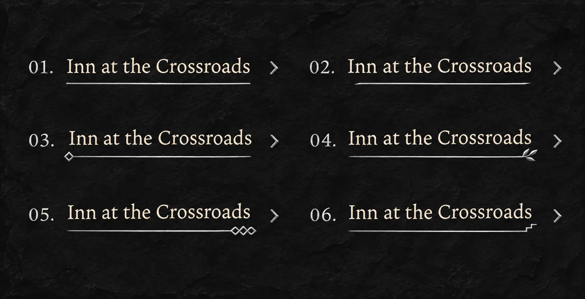

# Map location link

Six approved default dark-style variants. Parchment and light adaptations are deferred.

01 plain rule, 02 tapered ends, 03 leading diamond, 04 split-leaf end, 05 interlaced end, 06 stepped end.

Use inside a selected marker’s pop-up. Keep the location name live and wrap long names without displacing the trailing chevron. Preserve the existing destination and visible focus. Runtime implementation is pending.

