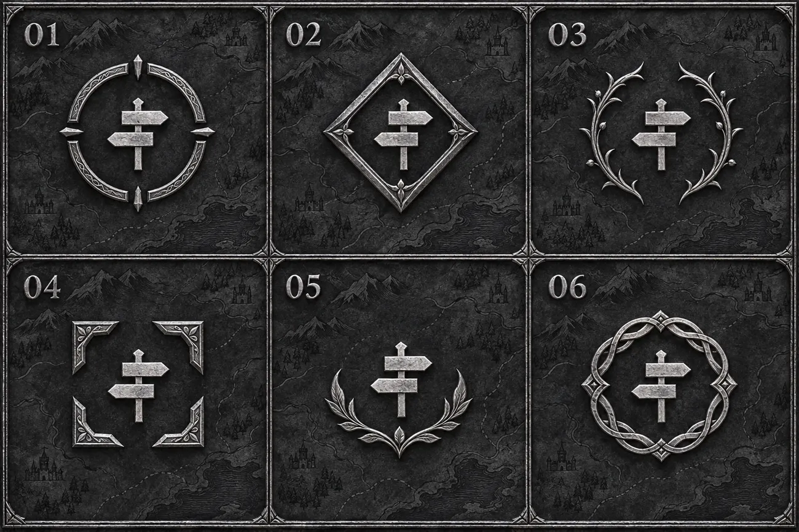
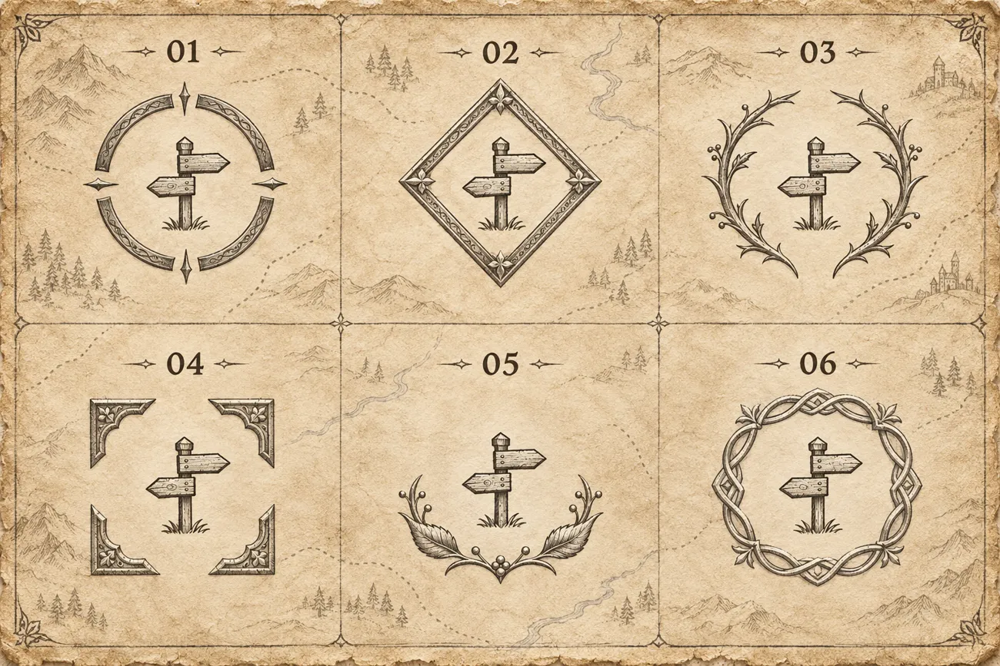
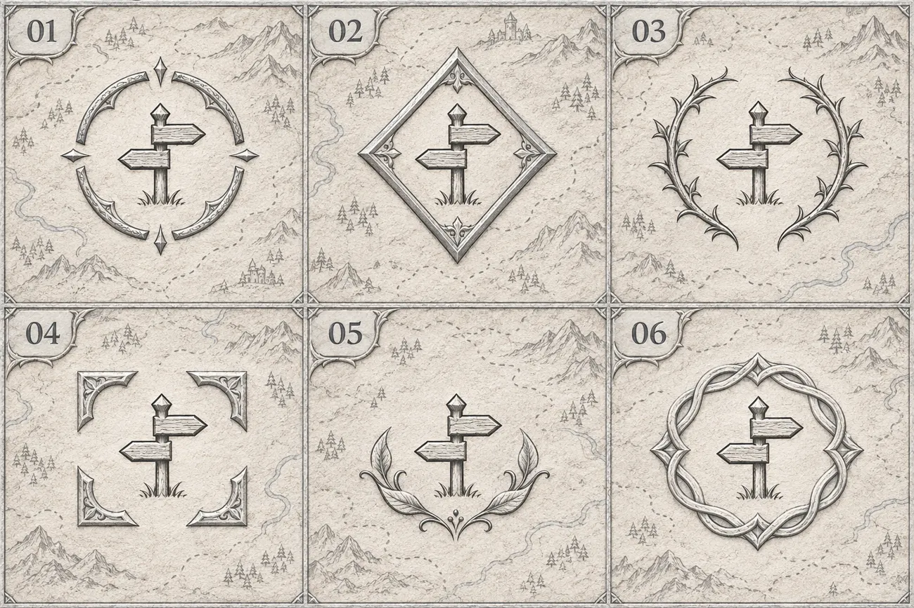

# Approved selected map marker surrounds

The owner approved all 18 surrounds. Use the set matching the map background. IDs are D01–D06 for dark stone, P01–P06 for parchment, and L01–L06 for light limestone. The signpost is a sample. Surround the existing map symbol, preserve its silhouette and test the selected state alongside nearby pins at iPhone size.

01 segmented ring, 02 beveled diamond, 03 thorn arcs, 04 corner brackets, 05 split-leaf cradle, 06 interlaced ring.

## Dark stone

## Parchment

## Light limestone

