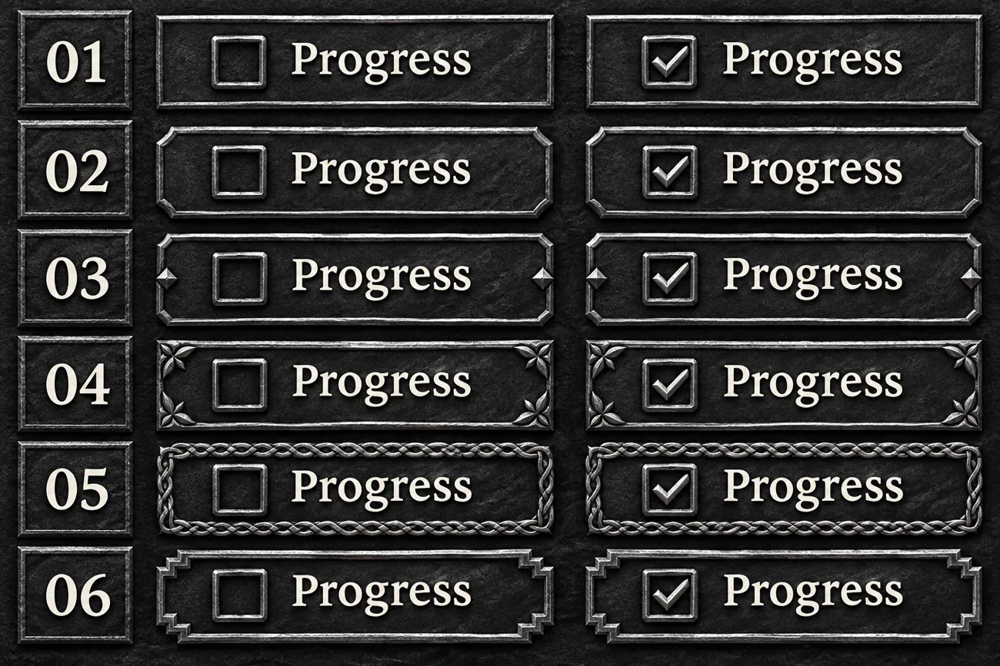

# Map Progress toggle

Six approved default dark-style variants. Parchment and light adaptations are deferred.

01 fine bevel, 02 clipped corners, 03 diamonds, 04 split leaves, 05 interlaced edge, 06 stepped steel.

Off is an empty checkbox and On is a silver check. Preserve the native checkbox, live Progress label, visible focus and existing map preference behavior. Runtime implementation is pending.

