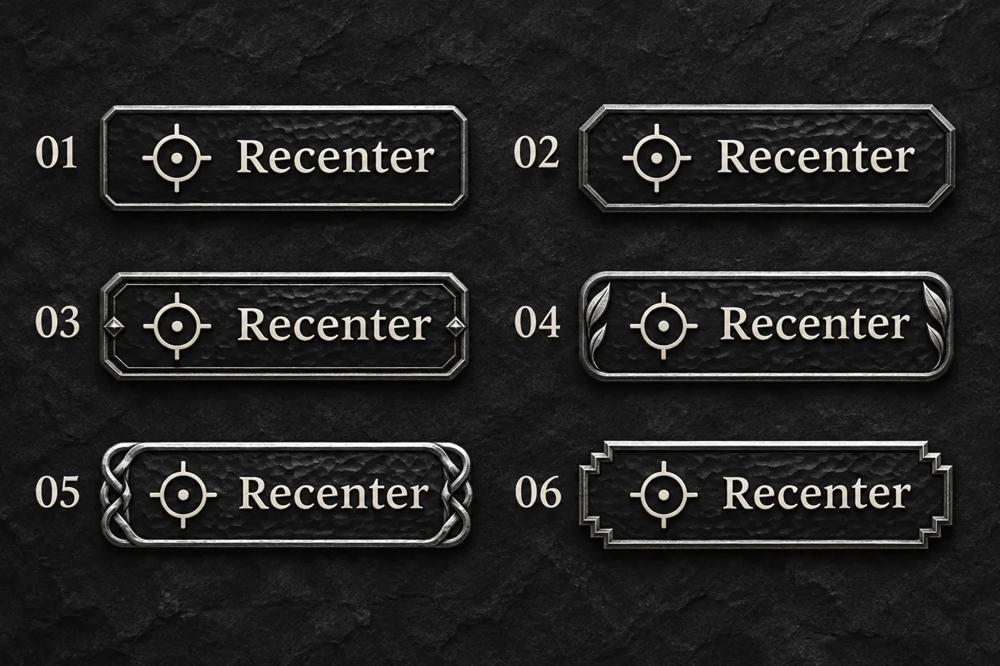

# Approved map Recenter control

Six default dark-style variants are approved. Parchment and light adaptations are deferred.

01 fine bevel, 02 clipped corners, 03 inset diamonds, 04 split leaves, 05 interlaced ends, 06 stepped steel.

Use the silver target icon and live ivory label. Match Back and Layers in the same toolbar. Recenter restores the map's opening view for the current entry context.

Runtime implementation is pending.
