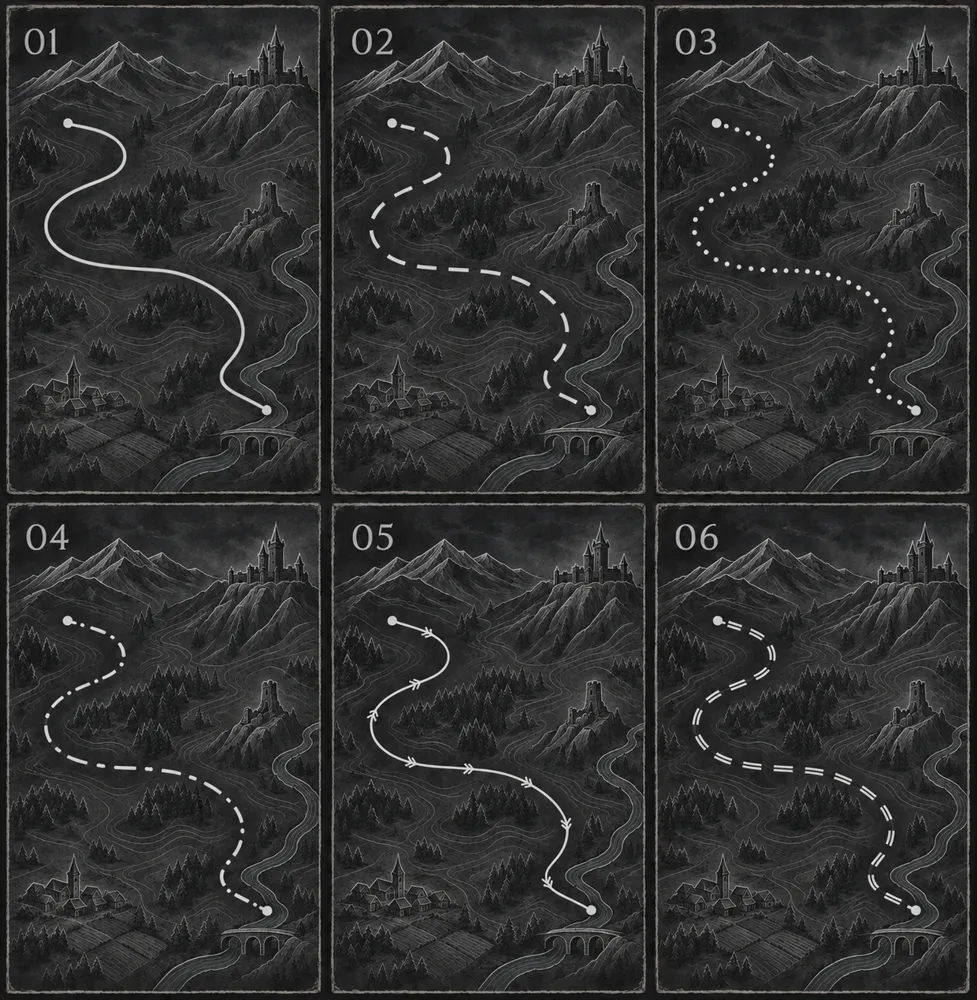
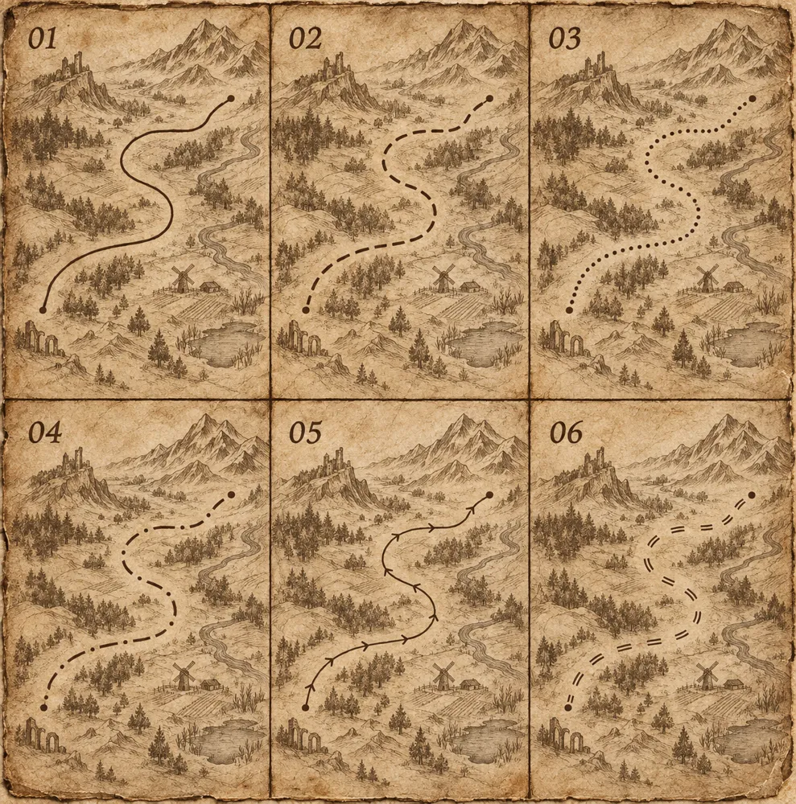
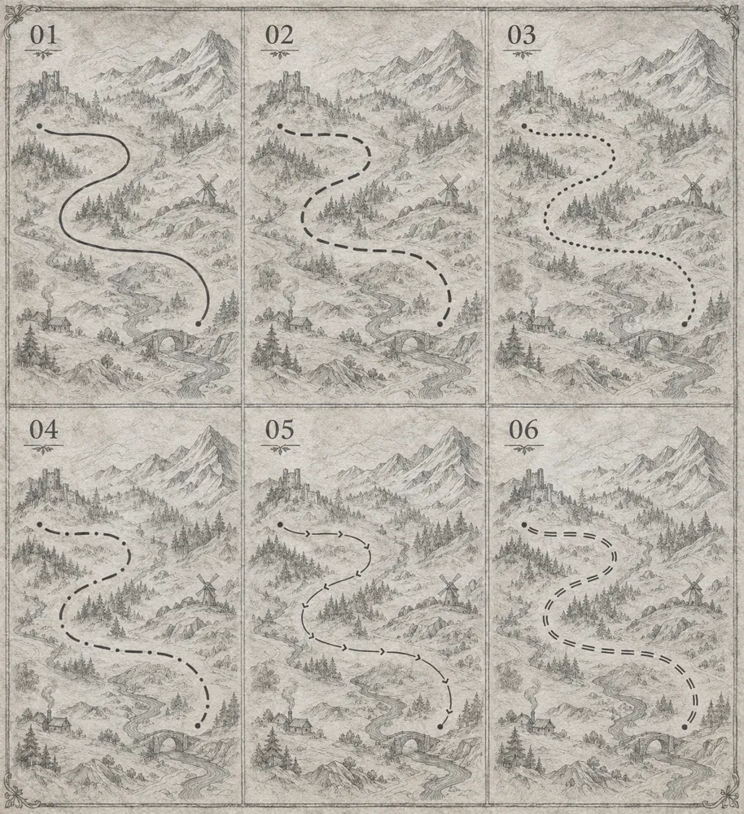

# Approved map route lines

The owner approved six patterns per surface. IDs are D01–D06 for dark stone, P01–P06 for parchment, and L01–L06 for light limestone.

01 solid, 02 dashed, 03 dotted, 04 dash-dot, 05 directional chevrons, 06 paired dashes.

The dark-stone reference uses fine silver outlines on terrain and landmarks, with higher contrast for the route. Preserve clear turns, legibility at iPhone size, and the distinction between route and terrain. The sheets use sample geometry. Apply the approved strokes to verified guide route data. Pattern meaning and runtime integration are pending.

## Dark stone

## Parchment

## Light limestone

