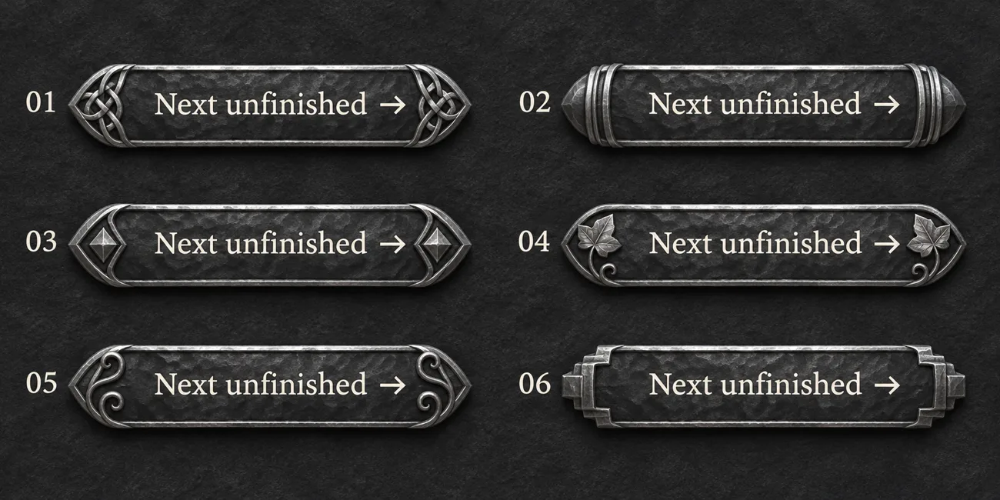

# Approved Next unfinished control

All six default dark-style variants are approved. Parchment and light variants are deferred.

01 interlaced knot, 02 wrapped collar, 03 inset diamond, 04 ivy leaf, 05 curled tendril, 06 stepped steel.

Use the approved reference with a legible ivory label, forward arrow and a raised rim that defines the silhouette. Keep the label live. The control moves selection to the next unfinished required objective.

Runtime implementation is pending.
