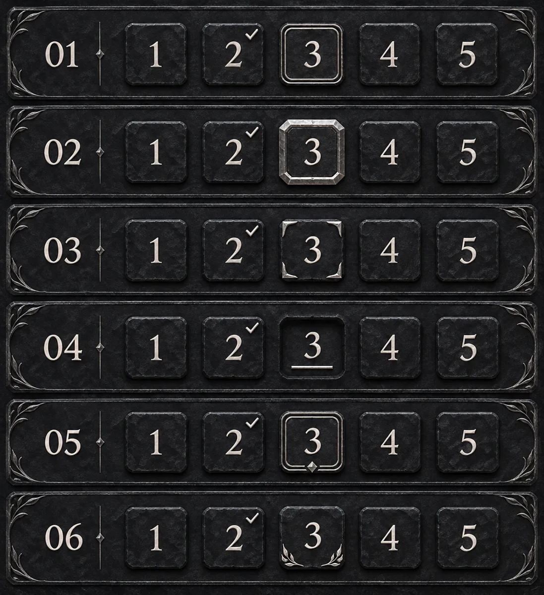

# Approved numbered objective rail

The owner approved all six default dark-style selected-number treatments. Parchment and light adaptations are deferred.

01 silver rim, 02 raised bevel, 03 corner brackets, 04 recessed underline, 05 double rim with diamond, 06 split-leaf corners.

In the reference, 3 is selected and 2 is complete. Keep the selection treatment and completion mark distinct, including when an objective is both selected and complete. The five sample numbers illustrate the states. Use the actual objective count, existing rail behavior and current touch target rules in the guide.

Runtime implementation is pending.
