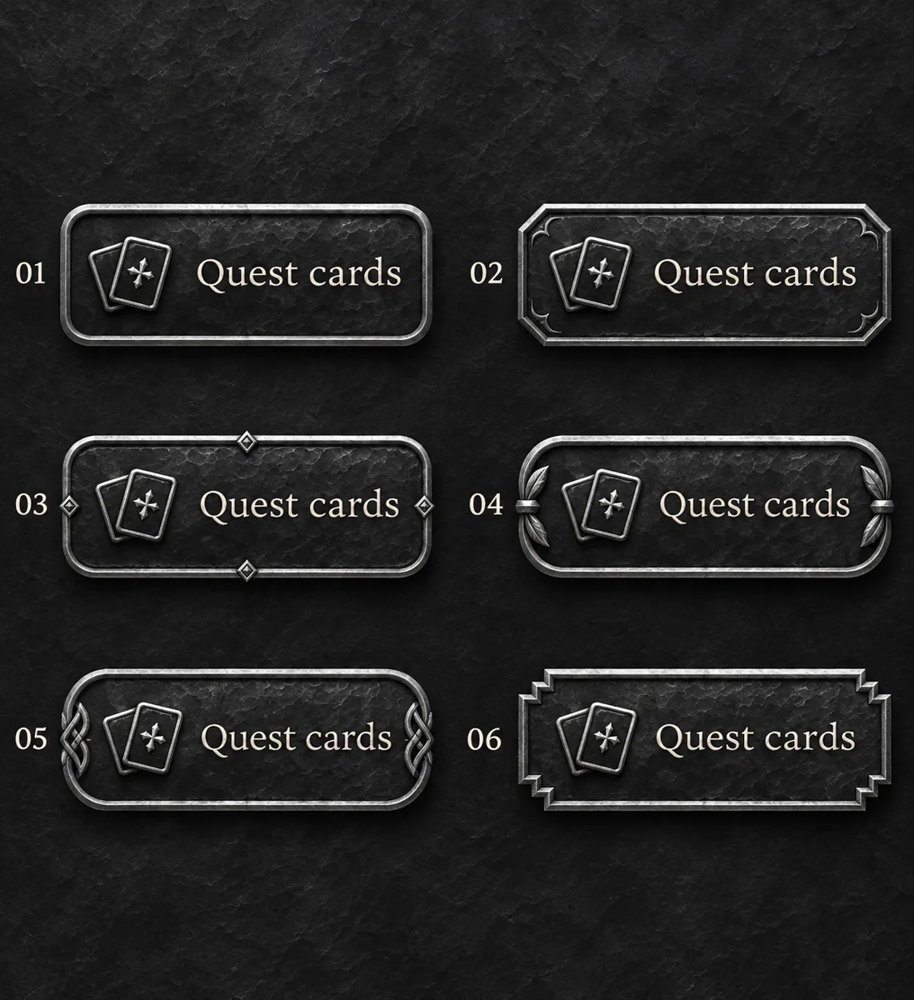

# Approved Quest cards control

All six default dark-style variants are approved. Parchment and light adaptations are deferred.

01 fine bevel, 02 engraved corners, 03 inset diamonds, 04 split leaves, 05 interlaced ends, 06 stepped steel.

Keep the live ivory label and silver card-stack icon. Align with the adjacent Return to hub control and preserve the existing quest cards destination.

Runtime implementation is pending.
