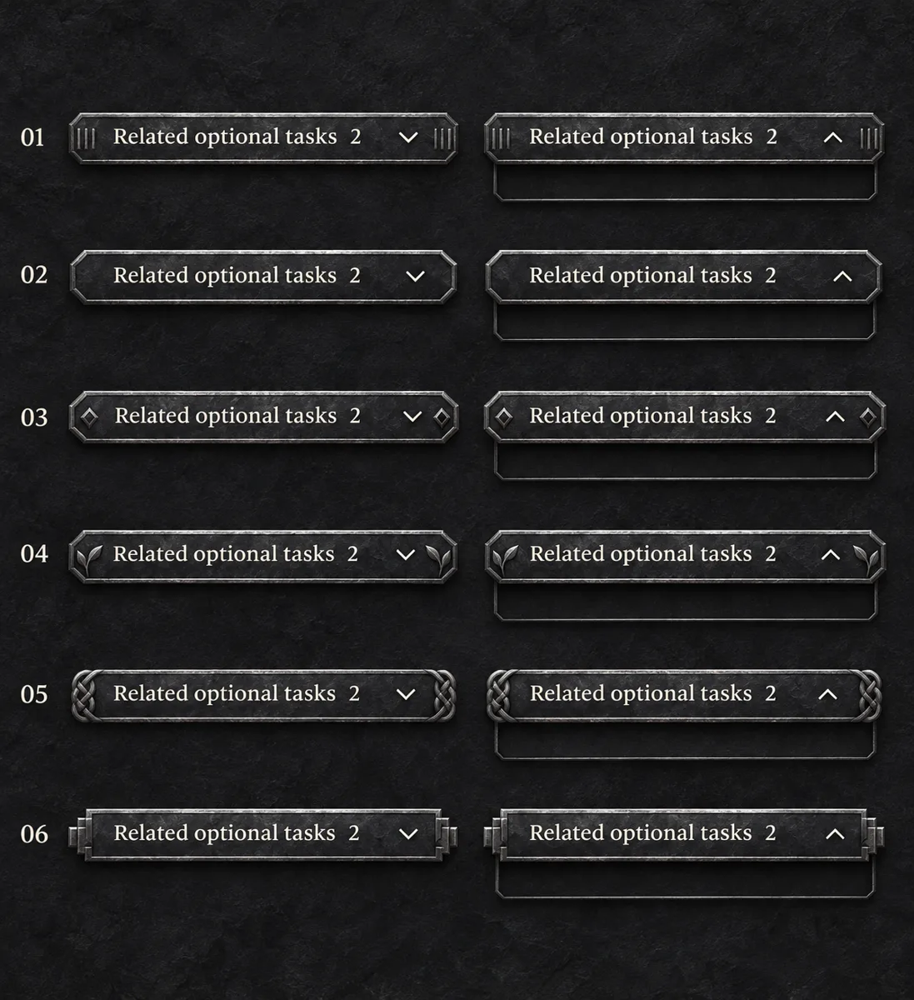

# Approved Related optional tasks disclosure

All six default dark-style variants are approved. Parchment and light adaptations are deferred.

01 engraved ticks, 02 beveled corners, 03 inset diamonds, 04 split leaves, 05 braided ends, 06 stepped caps.

Keep the live task count beside the label and the chevron at the trailing edge. Pair down and up chevrons with the closed and expanded states respectively. Keep native disclosure semantics and a visible focus state.

Runtime implementation is pending.
