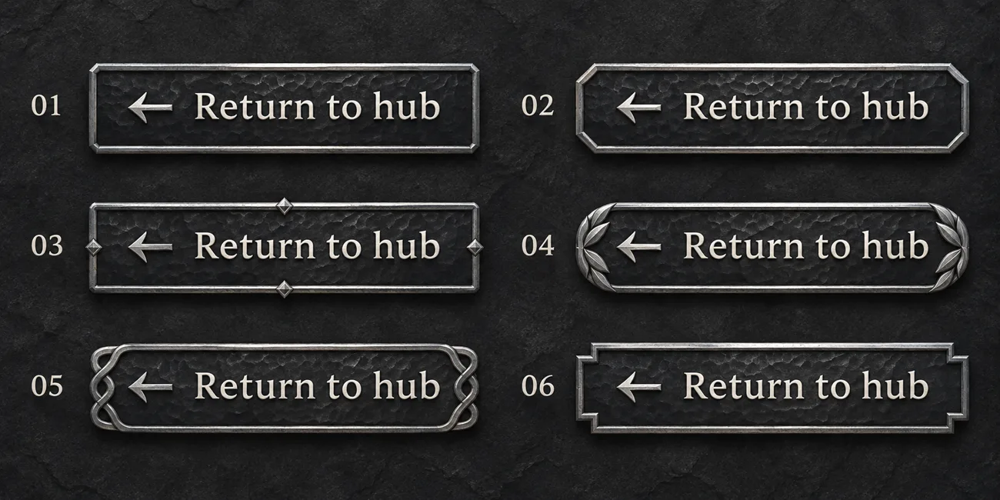

# Approved Return to hub control

All six default dark-style variants are approved. Parchment and light adaptations are deferred.

01 fine bevel, 02 engraved corners, 03 inset diamonds, 04 split leaves, 05 interlaced ends, 06 stepped steel.

Use the live ivory label and silver back arrow. Align with its peer Quest cards link and preserve the existing hub destination and return state.

Runtime implementation is pending.
