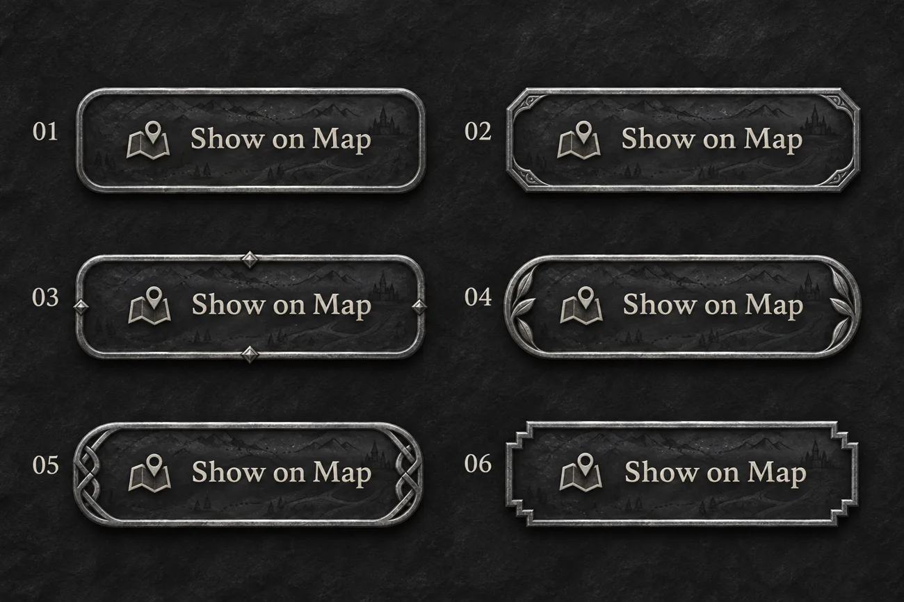

# Approved inline Show on Map control

All six default dark-style variants are approved. Parchment and light variants are deferred.

01 fine bevel, 02 engraved corners, 03 inset diamonds, 04 split leaves, 05 interlaced ends, 06 stepped corners.

The inline action sits beside the selected objective. Use the silver map icon, live ivory label and subdued map sketch from the design reference. Preserve map entry context and exact walkthrough return behavior.

Runtime implementation is pending.
