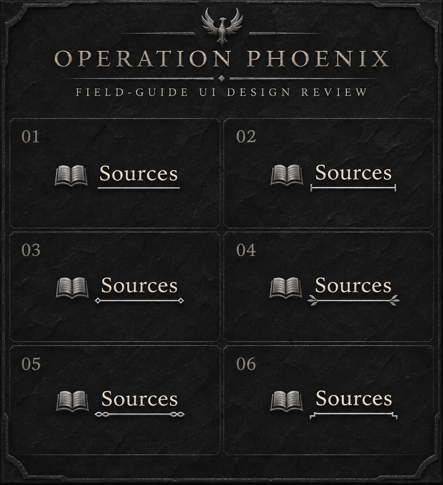

# Approved Sources link

All six default dark-style variants are approved. Parchment and light adaptations are deferred.

01 plain underline, 02 end ticks, 03 diamonds, 04 split leaves, 05 braided ends, 06 stepped ends.

Keep the live ivory link label, small silver book and quiet footer hierarchy. The review-sheet heading and frames surround the swatches for presentation only. Preserve the destination and visible focus.

Runtime implementation is pending.
