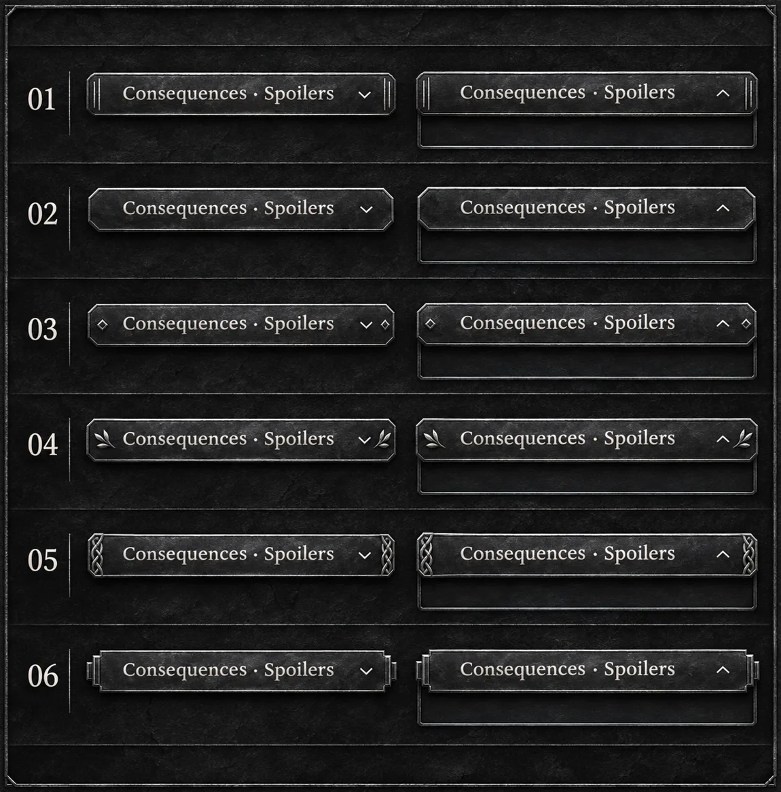

# Approved Consequences · Spoilers disclosure

All six default dark-style variants are approved. Parchment and light adaptations are deferred.

01 engraved ticks, 02 clipped bevels, 03 inset diamonds, 04 split leaves, 05 braided ends, 06 stepped caps.

Use the narrower treatment inside Information. Keep the spoiler content concealed until expanded and retain the trailing chevron, live label, native disclosure behavior and a visible focus state.

Runtime implementation is pending.
