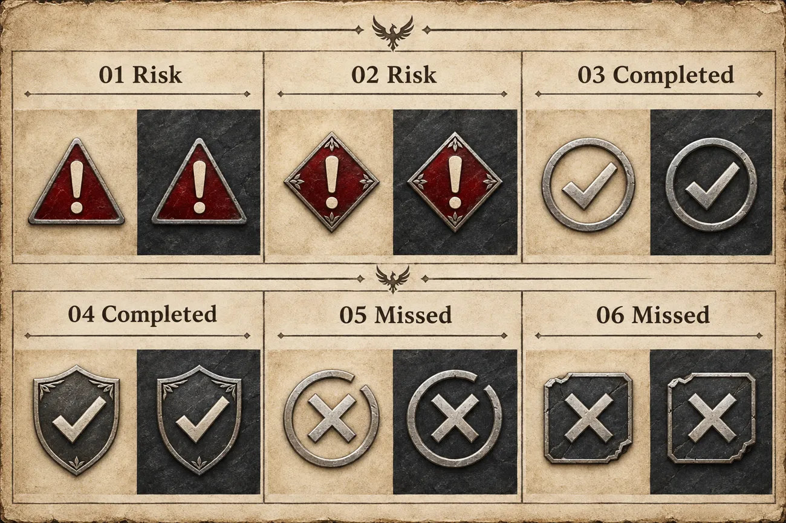

# Approved status marks

Owner approved all six designs. Use the approved artwork wherever these states appear across the guide. The sheets show each design on parchment and dark stone.

| State | Approved variants |
| --- | --- |
| Risk or missable | 01 oxblood triangle and 02 engraved oxblood diamond |
| Completed | 03 silver check ring and 04 steel check shield |
| Failed or missed | 05 silver X in a broken ring and 06 silver X on chipped slate |

Reserve oxblood for risk. Preserve the unambiguous exclamation, check or X in production artwork. Keep the status label available to assistive technology and verify the mark at iPhone size. The reference sheet is approved. Runtime integration and default selection are pending.

