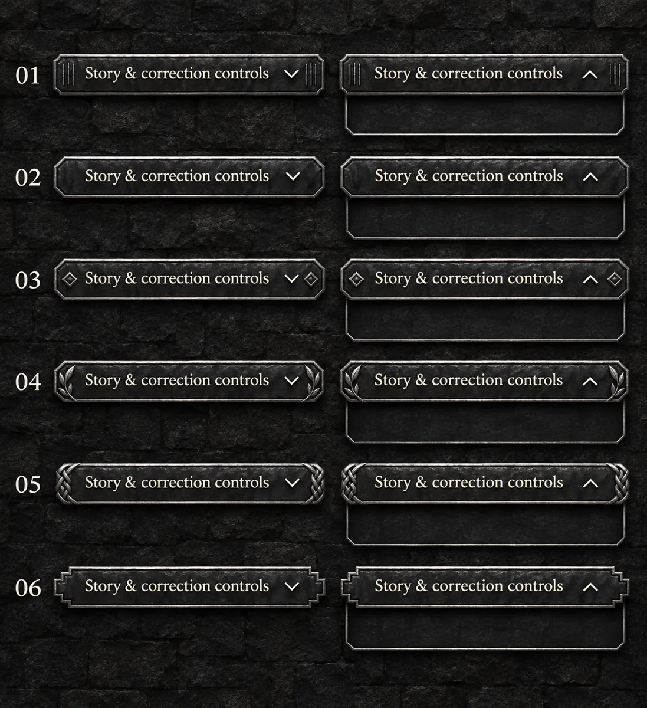

# Approved Story & correction controls disclosure

All six default dark-style variants are approved. Parchment and light adaptations are deferred.

01 engraved ticks, 02 beveled corners, 03 inset diamonds, 04 split leaves, 05 braided ends, 06 stepped caps.

Keep the long live label left-aligned with separate clearance for the trailing chevron. Match the other major disclosure headers. Preserve native disclosure behavior and visible focus.

Runtime implementation is pending.
