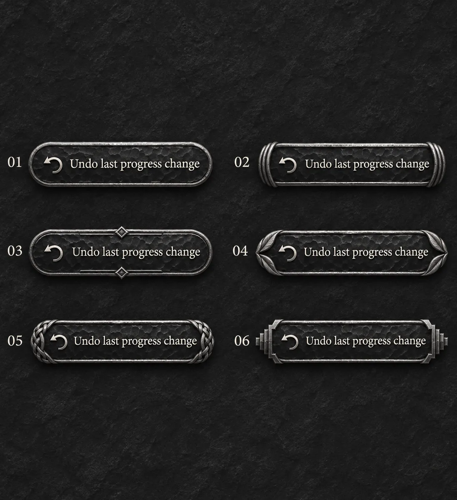

# Approved Undo last progress change

All six default dark-style variants are approved. Parchment and light adaptations are deferred.

01 fine bevel, 02 wrapped collars, 03 etched diamonds, 04 split-leaf tips, 05 braided ends, 06 stepped caps.

Use the live ivory label and silver undo arrow. Preserve existing undo scope, disabled state when no action can be reversed, and visible focus.

Runtime implementation is pending.
