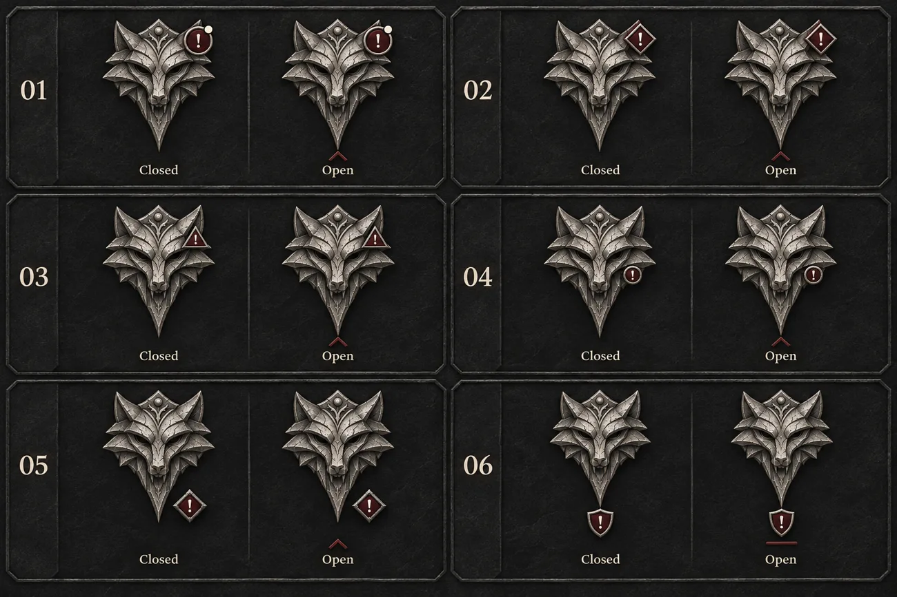

# Approved objective warning wolf

All six default dark-style variants are owner-approved. Preserve the existing silver wolf silhouette and use the selected badge placement and open-state cue from the sheet. Parchment and light adaptations are deferred.

The unread warning badge must pulse for visibility against dark surfaces. Use a subtle oxblood brightness pulse on the badge itself. Keep the exclamation readable, stop the pulse once acknowledged, and provide a static high-contrast badge when reduced motion is enabled. The open state has its own visual cue and accessible expanded state. Toggling the panel does not acknowledge the warning.

This is the approved visual reference. Runtime implementation is pending.
